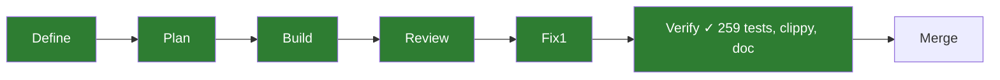

# 001 v1 front, search mocked

status: user check · rank: 5 · level: standard · type: feature · request: search-front v1 · session: search-front-001-v1 · process: ../../docs/workflows/development-process.mmd (frozen v20)

## Summary
Rank (rank.md): difficulty 5 (new repo, SSR app on ui-lib, a page with
states), impact 4 (future palicanon.app, nothing live yet) → 5.
The search page of today's site (Lsh0x/palicanon web: SearchBar, FilterBar
mode chips, ResultList, Footer), rebuilt in Leptos on ui-lib: AppShell (rail
with the search entry, theme, languages, env badge), a search bar
(role=search, / to focus), the mode chips words · meaning · both, the
results list (per-language title, snippet with highlights, found-via tag,
link to the sutta as today), empty / no-result / error states, the query in
the URL (GET ?q=&mode=) rendered on the server's first paint, desktop and
phone. Layout (user check round 3, 2026-10-05): the home (`?q=` empty) keeps
the centred layout — brand above the card mid-page, examples, daily passage.
A results page has a left-aligned header row capped at the reading width
(42rem): the brand (lotus + "PaliCanon") at the left, the search card beside
it, the results under the card in the same column; the card never spans the
page. Phone: the shell's top bar carries the brand, the row's brand is
hidden, the card takes the column's width. The build
badge sits at the footer's left, first in the phone's column, nothing on the
shell's panel (ui-lab 044, user 2026-10-05). Resolved by task 008 (2026-10-11): on a phone a
short page scrolled by the top bar's height (56px) — `Layout` wraps the page in
its own `min-h-dvh` column under `AppShell`'s already screen-tall column, and
renders `SiteFooter` as a child instead of through the shell's `footer` slot;
to rule at the next fix round. Round 5 (user, 2026-10-05, screenshots of palicanon.app beside :3101:
"je veux que ce soit la même chose… au niveau du search, le reste reste
tel quel", built by the orchestrator at the user's explicit request "fais
le toi-même"): the search is today's site's, class for class. Home: the
card's chips at the left of its bottom row, the submit alone at the
right (`Composer.tsx`), the hydrated menu opening at the left; examples
13px, `mt-5`; `pt-[max(4rem,20vh)]`. Results page: a full-width header
with a rule under it, the grid `[11rem_minmax(0,40rem)_1fr]` (brand
lotus 22 + `text-lg`, hidden on a phone; the one-line bar — search icon,
field, gold "Search" button, an arrow on a phone, `SearchBar.tsx`; the
last column free, the rail carries language and settings); under it, in
the bar's column, the two chips (outside the form, bound by
`form="search-form"`, a hydrated choice re-runs the search), then "N
passages" over a rule, the hits (`py-7`: reference, Pāli title 17px,
title 15px, the relevance bar at the right — score over the best hit,
found-via in its tooltip; a passage quoted with a gold rule, a blurb a
paragraph; "Read on SuttaCentral ↗"), the no-result state "No passage
matches “q”." with today's hint; matches marked as today (`mark`). Not
carried: the timings (the mock has none), the AI entries (no AI in v1),
the header's language and settings buttons (the rail). The footer links are Acknowledgements · Terms · Privacy ·
Support (no Legal), each a page copied from the old site's content
(web/src/locales pages.*, en/fr/vi), rendered like its Pages.tsx. The Footer comes
from ui-lib (task ui-lab 034). Search is MOCKED here:
a `SearchSource` trait with an in-repo mock returning fixed hits (shape of
api /v1/search's SearchResponse / HitDto); the real client (api task 002)
plugs in later. No AI, no infra.

## Workflow

## Log

| Step | Result | Output |
| --- | --- | --- |
| Define | done | user (2026-10-04): "on refait d'abord le front avec les modules existants + le footer (search mock), parallélise une lib client aussi" |
| Plan | done | lead (process msg 1485): slices listed (domain/mock, search bar, mode chips, highlight, results/states, page, shell); `IconName::Search` gap flagged, ruled by orchestrator: `Grid` stand-in until ui-lib's `feat/footer` (task 034) merges |
| Build | done | lead, no lanes spawned (built directly): commit `f326704` — 27 files, 45 SSR tests (down to the full page through the real router for a given request URL), clippy clean (ssr + hydrate/wasm32), rustdoc `-D warnings` clean, `fmt` clean; `cargo leptos build` green; probed in headless Chrome at 320/390/1280px (no overflow, all 4 states, GET mode-chip resubmission works post-hydrate); served on :3101 for the user's check |
| Review | done | reviewer (process msg 1523, diagram `review` d8a575dfb8c7149): a2m diff/module/sequence/impact + dotted `read` edges for `view!` call sites; 7 Δ findings, 5 T (missing test) findings; `@deep` answered (msg after 1522) — orchestrator ruled (msg 1525): FIX Δ5/Δ6/Δ7 + T1–T5 now, DEFER Δ1/Δ2/Δ3 to phase 2 (after api 002), Δ4 already ruled/accepted |
| Fix round 1 | done | lead: Δ5 (visible keyboard focus on the mode chips, `peer-focus-visible:` ring), Δ6 (`aria-live="polite"` wrapping the results), Δ7 (the results-count line, `results_label`), T1–T5 (unknown mode end-to-end, >200-char query, HTML-escaping, error sentinel × every mode, diacritic highlight through `ResultItem`) — each test written first and seen red (T1–T5 all went green on the first run with no code change: coverage gaps, not bugs). 53 tests (was 45), checks green (fmt, clippy ssr+hydrate/wasm32, rustdoc -D warnings). Probed Δ5's focus ring and Δ6/Δ7's new layout with CDP (real Tab key, `Emulation.setDeviceMetricsOverride`) at 320/390/1280px against the already-running `cargo leptos watch` (:3101, left running). Δ1–Δ3 recorded below, deferred, no code change. |
| Fix round 2 (user check) | done | 7796ac3: the page follows the URL on client-side navigation |
| Fix round 3 (user check) | done | lead (Opus): 12425f7/63378e9/bfe9179 header row (brand left, card beside, brand hidden below sm:), then the user's revision — f693a2a home centred again (Brand h1), 708e7ea results row (BrandLink text-[1.25rem] + card) inside the 42rem column, results under it; 1e3591d env badge off SiteFooter (shell panel only, Layout test); e58403c i18n guards (key parity fr/vi, hints follow the app's language) — no i18n gap found, green on first run, mutation probe red. 94 tests, all checks green |
| Fix round 4 (user check) | done | lead (Opus): 4d3dfa6 chips right — card row and chip group `justify-end`, hydrated Menu `right-0` (old FilterBar.tsx `Menu align="right"`); 874875a footer pages /acknowledgements /terms /privacy /support modelled on old Pages.tsx:88–172, texts = old web/src/locales/{en,fr,vi}.json `pages.*` verbatim as generated Rust data (`app/src/pages/content_<lang>.rs`: leptos_i18n reads JSON arrays as plural ranges, parser parsed_value.rs:1523), placeholders resolved (publisher Thibault Rivière, contact riviere.thibault@icloud.com, date 2026-10-01 from old Pages.tsx:8–10), Legal page and its two pointers (Terms/Privacy intros) dropped — open question to the user (process msg 2160); footer = four links from `PageKind::ALL`, labels = old `footer.nav_*` (fr Crédits, vi Tri ân). Every test red first (2 + 14). 112 tests, all checks green |
| Fix round 5 (user check) | done | orchestrator, at the user's request ("fais le toi-même"): the search as today's site, home and results (Summary); `SnippetKind` and `score` on `HitDto` (the quote / paragraph and the relevance bar need them; `Eq` dropped, float); `Select` gains `form` and `submit_on_change`; new `ui/search_row.rs`; locales: `read_link`, `results_label`/`results_one`, `no_result_*`, `relevance_label` from the old `search.*`. 120 tests (was 112), fmt, clippy ssr, rustdoc `-D warnings` green; the watcher rebuilt the wasm (hydrate compiles); CDP capture at 1280 and 390 (mobile emulation, scrollWidth = viewport), home and results, looked at |
| Verify | done | orchestrator, 2026-10-12, on feat/v1-front 27f028c: fmt, leptosfmt, clippy ssr all-targets, clippy hydrate wasm32, 259 tests, rustdoc — all 0. Carries 002–006, 008, 009 and the licence (826c84c) |
| Check | done | user, 2026-10-12: "ajoute … la licence, le 404, et le fix du tel" — merge on main |

## Before the merge
- ui-lib main pushed to GitHub at 7e39d28 (user "push !", 2026-10-05): search-front's CI and deploy fetch `PaliCanon/ui-lib` main by git, the local `[patch]` does not exist on a runner (006).
- Tasks 002, 003, 004 and 006 ride on this branch and are checked; the phone short-page scroll (open point above) is still to rule.

## Forks

Ruled by the orchestrator (process msg 1525) to defer to phase 2 (once
`api` task 002's real `/v1/search` client lands), recorded here rather than
fixed now:

- **Δ1** — the mock's `SearchResponse`/`HitDto` (`app/src/search/mod.rs`)
  are trimmed vs the API's wire shape (missing `lang`, `k`, `timings`,
  `degraded`, `segment_key`, `snippet_kind`, `pali`, …): the real client
  needs a translation/adapter layer, not a drop-in swap, contrary to this
  task's "mirrors the wire format" framing. Decide in task 002: share the
  wire type (e.g. a `palicanon-api-types` crate) or keep `search-front`'s
  own trimmed DTOs behind an explicit adapter.
- **Δ2** — no segment-anchored read link (`#segment_key`) on passage hits,
  depends on Δ1's missing `snippet_kind`/`segment_key`; today's site's
  `readUrl()` anchors to the quoted passage, search-front always links to
  the bare `hit.url`.
- **Δ3** — the UI's own `?mode=` codes are `words`/`meaning`/`both`, the
  API's are `words`/`meaning`/`hybrid` (`search_core::Mode`); the real
  client must translate `both`↔`hybrid` at the plug-in boundary — decide
  where that translation lives (api task 002's client, or `Mode::code`
  itself) when it is built.
