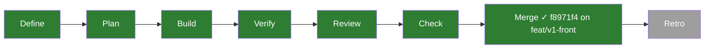

# 005 The real search — the page answers through the PaliCanon API

status: merged · rank: 6 · level: hard · type: feature · request: user, 2026-10-05 ("Ensuite on branche le search !") · session: search-front-005-real-search · process: ../../docs/workflows/development-process.mmd (frozen v20) · after: [001]

## Summary
Rank (re-ranked 5→6 at the check, 2026-10-05: a pre-existing API bug found — the collections filter lets a top hit through, api 004 — and every review round on a single voice or none): difficulty 5 (an async client behind a server fn in Leptos SSR, a token held by the server only, three wire-shape forks from 001, response statuses set from the render), impact 5 (the first real search of the site's successor; every query goes through it) → 5. Level hard: security (the token), two repositories' types, a design that moved over two rounds — the main orchestrator runs it.
The page stops using the in-repo mock for real queries: a `#[server]` fn `search_passages(q, lang, mode, collection)` is the page's ONLY search path (on the server it calls the configured source; the WASM calls it over HTTP — no mock and no token in the WASM); it always returns `Ok(SearchOutcome = Hits | Cold{retry_after} | RateLimited{retry_after} | Failed)` (a `ServerFnError` would be a 500). One `Resource` at `SearchPage` level keyed on (q, lang, mode, collection), under one `Transition`; the route renders in `SsrMode::Async` so the first paint carries the hits without JS; a blank `q` returns an empty outcome with no API call; `q` is capped at 200 characters (the input's `maxlength`, the server as safety net) and an unknown mode defaults to both as today. On client-side navigation the stale hits stay only while pending (`aria-busy`, dimmed) and the outcome always replaces them. `RealSource` wraps `palicanon-api-client` (git dep on PaliCanon/api, optional under `ssr`): `SearchQuery::new(q).lang(lang).k(20).mode(wire)`, `.collections(code)` only when the collection is not All (today's site sends nothing for All; `all` is no API code), inside `tokio::time::timeout(30 s)` — a timeout is Cold (503, `Retry-After: 10`): the engine takes up to a minute to wake, as the site knows (ruled at Plan); one enum `Source { Mock, Real }`, built once at boot and cloned into the context (read with `expect_context`, no `OnceLock`). Boot: `SEARCH_API_URL` + `SEARCH_API_TOKEN` → Real; neither → Mock with one log line; a set but empty token refuses to start; the token lives in a newtype with a redacted `Debug`, never built in, never in a file (security.md, retro 022). Adapter (one seam, `app/src/search/adapt.rs`): wire `HitDto` → the page's trimmed DTO (001 Δ1 kept); read link as today's `readUrl()`: the anchor is `snippet_key` when it matches `^[a-z]+[\d.-]*:[\d.]+$`, replacing any fragment the wire `url` already carries (Δ2; ruled at Plan from the reference); `both` ↔ `hybrid` only here (Δ3); a body that does not parse is Failed. Errors → page states: Cold → "the engine is waking up, try again shortly" (no countdown number in the HTML; `Retry-After` carries it), RateLimited → "too many searches, wait a moment" (`Retry-After` only when the API gave one — v4), Failed → today's generic error; on the SSR path the response status is 503 / 429 (with `Retry-After`) / 502, and `Cache-Control: no-store` only on a non-empty `?q=` — set under `cfg(ssr)` through `use_context::<ResponseOptions>`. The server logs status, code and duration, never the query; `DefaultBodyLimit` on the server fn route. Run command (README, no .env): `SEARCH_API_URL=https://api-dev.palicanon.app SEARCH_API_TOKEN=$(security find-generic-password -a pali-canon-api -s pali-api-token-dev-site -w) cargo leptos watch`. Out of scope (user, 2026-10-05): the deployed dev front. From the reference, in scope (ruled at Plan): a 404 `lang_unavailable` answer retries in English and the page shows the site's `fell_back` note (three strings); optional last slice: the 3 s "waking" note on client-side navigation. Follow-up: `corrected_query` and `degraded` shown (followup-corrected-query). Assumed, to confirm at the check: api-dev with the keychain token; k = 20 (today's site); the 10 s timeout; the statuses 503/429/502.
Tests: `RealSource` against a mock axum server (200 full wire body, 401, 429 with retry-after, 503 engine_starting, non-JSON body, a timeout); adapter (segment anchor on a passage, none on a blurb or an empty key, both↔hybrid both ways, every optional None); SSR: Cold and RateLimited states in en/fr/vi, `SsrMode::Async` pinned, the statuses and headers, a sentinel token absent from the rendered HTML, the error page and the `ServerFnError` body (the WASM grep is a verify-step script); boot: no env → Mock, env → Real, empty token → refused; the server fn: blank q, 201-character q, unknown mode.
Consensus: single voice (deep, two rounds; gemini 429 throughout, sage failed three times) — the user is told.

## Workflow

## Log
| Step | Result | Output |
| --- | --- | --- |
| Define | doing | session opened 2026-10-05 (discussion d4ea774a36d0447, process d64670fcb7b9a47, design d622b5ffa138b4f, review dda55ea42029340); need + ask-yourself posted (#2390); user: no dev deploy; consensus agent: v3 at consensus on deep alone (#2552). Next: the user's validation of v3 |
| Plan | done | lead (Sonnet): 6924223 — 7 slices in build order + 1 optional, no overlap (feat/v1-front is the base; api 003 is another repo); reference check vs today's site found three wording differences, ruled by the orchestrator (process, after #3184): anchor by `snippet_key` as `readUrl()`; `All` sends no `collections`; timeout 30 s → Cold; the English fallback on `lang_unavailable` + `fell_back` note in scope; slice 8 (3 s waking note) optional last; dev-deps `futures` + `any_spawner` (in the lock) accepted; `wt/api -> ../api` symlink created by the orchestrator. Probe: `DefaultBodyLimit` answers 500 not 413 (tests assert rejection + zero calls) |
| Build slice 1 | done | lane (Sonnet): 20a5758 — outcome types, async trait (`#[allow(async_fn_in_trait)]`), `Mode::wire_code/from_wire`, `Collection::wire_code`, mock sentinels Cold/RateLimited, api-client dep + root `[patch]` (api-types re-exported by the client: no second dep), stubs gated ssr (`server` ungated); 128 tests (was 117); five reds quoted; `outcome_serde_round_trip` green on arrival (a derive). Orchestrator rulings: `SearchFailure { Cold, RateLimited, Failed }` with `From` into the outcome accepted; `SearchError` removed accepted; the page's sync shim `MockSource::answer` accepted until slice 6; `result_list.rs` test literals and the page's one call site touched (outside the row's files) accepted; `any_spawner` with `tokio` feature accepted |
| Build slice 2 | done | lane (Sonnet): ea6f2f6 on a sibling worktree, cherry-picked as 53bc0c9 onto feat/real-search — `adapt::response(wire, fell_back)` / `adapt::hit`, the anchor exactly as today's `readUrl()` (the old fragment stripped only on the anchored path; a hand-written segment-id matcher, no regex crate); 20 tests, 10 red on a naive stub, the rest red under the always-append mutation; checks 0. Rulings: `#[allow(dead_code)]` on `response` until its caller lands accepted; wire hits built from JSON in tests (no `search_core` dep) accepted |
| Build slice 3 | done | lane (Sonnet): 9be31c9 — `RealSource::new(base_url, ApiToken, Duration)`, `API_TIMEOUT` 30 s (a timeout is Cold with retry 10), the English retry on 404 `lang_unavailable` with its own timeout, `All` sends no `collections`, log line with status/code/duration only (code filtered `[a-z0-9_]`, 40 chars), `ApiToken` redacted `Debug`; mock axum API in `test_support.rs` (port 0, counter, captured query and Authorization); 27 tests, 26 red on a stub, three mutations quoted; checks 0, 155 tests. Accepted: the retry's own timeout (worst case 60 s); `#![allow(dead_code)]` on `real.rs` until slice 4. Integration (deep #3212: the two worktrees had different bases): the temporary `to_page`/`to_hit` in `real.rs` are replaced by `adapt::response`/`adapt::hit` by the next lane with the `real::` tests re-run — an owned step; the Lanes row 3's 10 s corrected to 30 s here |
| Build (integration + slice 4) | done | lane (Sonnet): c50bd58 RealSource through `adapt::response` (red: `a_passage_hit_comes_back_with_its_read_link_anchored_on_the_snippet_key`, url bare → anchored; the temporary pair deleted, no test had pinned the bare url), 176 tests; b5f1d9b `Source { Mock, Real }` by delegation (4 tests, Real against the mock API) and `boot::Config::from_lookup` (9-row table; `BootError::{Missing, Empty}` naming the variable, values trimmed, `Debug` without the token; red by empty-as-unset), 187 tests; checks 0 at both. Rulings: no `Clone` on `Source` (the client has none) — the router holds `Arc<Source>` and provides it as context, slice 7 as planned; `ApiToken`/`RealSource` `pub` in `pub(crate)` modules accepted; `main.rs` reaches the source through `boot::Config::into_source` |
| Build slice 5 | done | lane (Sonnet): cba1d89 — `#[server(endpoint = "search_passages")]` delegating to `answer(Result<Arc<Source>, ServerFnError>, …)` then `search_passages_with(&Source, …) -> SearchOutcome`; `Request::from_args` bounds (trim, blank → `Hits(SearchResponse::empty)` with zero calls, 200 characters not bytes, unknown mode/lang/collection defaults); Cold/RateLimited/Failed always `Ok`; 9 tests (reds: the cap removed → 201 vs 200 twice; Cold mapped to Err → `None` vs `Some(Cold)`), 196 tests, checks 0. Accepted: `SearchResponse::empty` in `mod.rs`; per-argument docs and the module-level clippy allow the `#[server]` macro forces under hydrate; the route is registered in slice 7 |
| Build slice 6 | done | lane (Sonnet): 6f4aa3f states (`ColdState`, `RateLimitedState`, the `fell_back` note, locales en/fr/vi from the site's strings) and e33b396 page — one Resource under one Transition, `/` in `SsrMode::Async` (pinned by `generate_route_list`), the fetcher calls `search_passages` (on ssr its body reads `Arc<Source>` from the context, the tests provide it), 503/429/502 + `Retry-After` and `no-store` through `use_context::<ResponseOptions>`, the pending rule as a pure state fn; harness `page/harness.rs` (`to_html_stream_in_order` under `any_spawner`, a 10 s stream timeout, one process-wide lock around renders and the route walk — parallel runs hung without it); reds quoted (role=alert, role=status, the hit absent, no `ssr=`, no 503, `expect_context` panic); 223 tests, checks 0. Accepted: app.rs's footer test moved to the async harness; the brief's "25 tests" was 21 |
| Build slice 7 | done | lane (Sonnet): f6e2e44 — `router(options, Arc<Source>)` with `leptos_routes_with_context` + `file_and_error_handler_with_context`, `DefaultBodyLimit` 8 KiB on the server-fn route, `main.rs` reading the two variables through `boot::Config` (refuses to start on an error, prints the log line), README run command (keychain token, no .env), `scripts/check-wasm-no-token.sh`; 8 router tests over the real router (reds: a stub router → 404 vs 503, no `no-store`; the layer removed → 200 instead of a rejection; the token pushed into the outcome → "token leaked"), 3 process tests in `tests/boot_process.rs`; checks 0, the script 0 clean / 1 with a planted canary; 234 tests |
| Verify | done | orchestrator: on the branch f6e2e44 — 234 tests, clippy ssr all-targets, fmt, leptosfmt all 0; `cargo leptos build` + the script 0 (lane 7). Verified against `../api` main cac85d3 (the client crates by local `[patch]`) and ui-lib main 6e37720. The front started on :3105 against api-dev with the keychain token (the user's check); reviewer (Opus) briefed |
| Fix round 1 | done | lane (Sonnet): 90ad504 mock gated ssr + the script greps `MockSource` and the sentinels (the bundle never held them: dead code eliminated — source-level finding, red on a fake pkg dir); 5248970 wire codes moved to `adapt.rs`, `SearchFailure` kept as the one table (every `Failed` through it); 62eb9ac `search: source missing` log line; 9f8f1e3 trimmed key, one `empty` builder; db47bf6 Retry-After clamp 1..=300 end to end; dfecb2d route refusals exact (500 by body; a wrong content type with a valid form is 200 — leptos reads the body regardless, pinned); 238 + 3 tests, checks 0, script 0. Round 2 posted with the fix diff and the four files the voice window dropped |
| Check (orchestrator) | done | :3105 against api-dev: `how to deal with anger` 20 passages in 0.8 s (first query: the cold engine → 503 after 30 s, as designed); `metta` words mode 3 passages with segment anchors; a French query 20 passages on fr translations; `satipatthana` meaning mode 23; `anger` + MN filter → 21 hits with iti4 first — the API's bug (reproduced directly: api 004 opened), the front forwards `collections=mn`; `no-store` on every `?q=`; no token byte in any page. Captures 1280/390 looked at. The user's check pending |
| Fix round 2 | done | lane (Sonnet): 907e955 router tests split (wrong content types vs a partial form — the partial-form 500 is leptos's own, no red possible), bab6f17 `ResponseSpec` carries the `no-store` rule from the query (red by `if false &&`), eb17fdf the stale alert pinned (busy/dim + settled halves), 6646cc1 the English fallback at page level with the French note (MockApi 404 then 200, two calls), e84ba02 the key carries mode/collection/language, b1157c5 five script tests on a planted bundle; 244 lib + 3 + 5 tests, checks 0, build + script 0; T4: one test alone ok, the suite single-threaded twice ok, all 244 each alone in reverse order 0 failed, no stall. Round 3 posted |
| Fix round 3 | done | lane (Haiku): 373c731 — four tests (a `.wasm` fixture caught; the language alone re-keys; the empty `q=` form is a 200 no-op with zero calls; Cold/RateLimited/Failed through the blank branch set nothing), each red by its mutation (quoted); 256 tests (247 lib + 3 boot + 6 script), checks 0. The three review rounds are spent: the user decides at the check |
| Check (user) | done | user, 2026-10-11, used the search on :3105: "merge both". Confirmed by use: api-dev with the keychain token, k = 20, the 30 s timeout |
| Define (user) | done | user, 2026-10-05: "branch d'abord on déplace après" — v3 validated; api 003 (api-cli) comes after, as a Cargo bump. Worktree `wt/search-front-005-real-search`, branch `feat/real-search` from `feat/v1-front` (merged back into it before 001's merge). Lead (Sonnet) briefed for Plan |
| Plan | done | 7 slices in build order (+ 1 optional), no overlap with an open branch; reference read (`web/src/api.ts`, `App.tsx`, `functions/v1/[[path]].js`) → 5 questions to the orchestrator; probes: api-client patch (exit 0), Async SSR + status/header + body limit through the real router (exit 0) |

## Design
Viewer: search-front-005-real-search/design, v3 validated by the user; v4 = v3 + the review rulings' wording (RateLimited's Retry-After only when given; the server fn reads the source with `use_context`, a missing source is logged and answered as a ServerFnError). (consensus 2026-10-05; validated by the user 2026-10-05: "branch d'abord, on déplace après" — the client stays in PaliCanon/api until api 003 moves it to api-cli; then a bump).

```mermaid
flowchart TB
  subgraph today["search-front today (feat/v1-front)"]
    tr["app/src/search/mod.rs — trait SearchSource (SYNC): search(query, mode, collection) -> Result#lt;SearchResponse, SearchError#gt;\nMockSource (fixture); the page calls it while rendering, on the server AND in the WASM (client-side navigation re-renders with the mock compiled in)"]
    dto["app/src/search/mod.rs — the page's own HitDto/SearchResponse (trimmed: no lang, k, timings, segment_key…) (001 Δ1)"]
    pg["app/src/page.rs — reads ?q=&c=&mode=, renders results, empty, no-result, error states; Mode codes words/meaning/both (001 Δ3); page_for rebuilds everything inside one reactive closure"]
  end
  subgraph client["already built: PaliCanon/api main 146496b"]
    cl["palicanon-api-client: Client::new(base_url, token) (a plain reqwest::Client, NO timeout), async search(&SearchQuery) -> Result#lt;SearchResponse, ClientError#gt;\nClientError: Unauthorized · RateLimited{retry_after} · ColdEngine{retry_after} · Other{status,code,message} · Request\npalicanon-api-types: SearchResponse (corrected_query, degraded, …), HitDto (url and segment_key are plain Strings), search_core::Mode (words/meaning/hybrid)"]
  end
  subgraph after["after (task 005) — search-front only, Leptos 0.8.21 / leptos_axum 0.8.10"]
    boot["server/ boot (app/src/main.rs, ssr) — SEARCH_API_URL + SEARCH_API_TOKEN read once, never built in (retro 022); no env!, no build.rs\nboth set and token non-empty → Real · neither set → Mock + one log line #quot;search: mock#quot; · only one set, or token empty (a failed keychain read) → REFUSE TO START, naming the variable, never its value\nthe token lives in a newtype whose Debug is redacted; the Source is built ONCE here and cloned into leptos_routes_with_context(provide_context(Arc#lt;Source#gt;)) — never env::var per request, so the SSR test's context and production cannot diverge — this also registers the #[server] fns and gives them the same context (read in leptos_axum 0.8.10: no hand-written /api route); a DefaultBodyLimit of a few KiB on the router"]
    src["app/src/search/source.rs — async trait SearchSource (mod.rs) and ONE enum Source { Mock(MockSource), Real(RealSource) } implementing it (no dyn, no boxed futures; a test matches the enum exhaustively)\nall cfg(feature = ssr): the mock, the api-client and api-types (optional deps behind ssr) never enter the WASM\nsearch returns Result#lt;SearchResponse, SearchFailure#gt;, SearchFailure = Cold | RateLimited | Failed (serde)"]
    real["app/src/search/real.rs — RealSource { client: shared reqwest-backed Client }: SearchQuery::new(q).lang(lang).k(20).collections(collection.code()).mode(mode.wire_code()), the whole call inside tokio::time::timeout(10 s) (a precondition of SsrMode::Async)\nColdEngine → Cold · RateLimited → RateLimited · timeout, Unauthorized, Other, Request, a body that does not parse → Failed (Unauthorized logged loudly: an operator fault, never shown as #quot;unauthorized#quot;)\nlogs: status + code + duration only, never q, never Other.message"]
    ad["app/src/search/adapt.rs — the adapter, one fn per type: wire HitDto → page HitDto (Δ1 kept: the page's DTO stays trimmed, behind this one seam)\nread link = url + #quot;##quot; + segment_key when the hit is a passage AND segment_key is non-empty, else the bare url (Δ2, today's readUrl())\nMode: both ↔ hybrid at this seam only (Δ3): Mode::wire_code(), Mode::from_wire(); corrected_query and degraded are ignored in v1 (follow-up)"]
    sfn["app/src/search/server.rs — #[server] search_passages(q: String, lang: String, mode: String, collection: String) -> Result#lt;SearchOutcome, ServerFnError#gt; (POST)\nSearchOutcome = Hits(SearchResponse) | Cold | RateLimited | Failed: ALWAYS Ok(…), so a cold engine is never a 500 in monitoring on the browser path\nbounds, on the server: q trimmed, capped at 200 chars (the safety net for hand-made URLs; the search input carries maxlength=200 so the form never submits more and the address bar cannot disagree with the hits), blank → Ok(Hits(empty)) with NO API call; k = 20 here, never from the browser; lang parsed to en/fr/vi, mode and collection parsed to enums (never forwarded raw)\nreads the Source with expect_context; the only way the page searches"]
    res["app/src/page.rs — ONE Resource created at SearchPage level (not inside the reactive closure), keyed on (q, lang, mode, collection), fetcher = search_passages; the Transition boundary is always present (home and results alike: the same tree on server and client)\nthe route renders with ssr=SsrMode::Async: the server waits for the API before sending anything, so the first paint carries the hits without JS (out-of-order streaming needs JS to swap its fallback)\nclient-side navigation: Transition keeps the previous results ONLY while the next ones load, and marks them pending (aria-busy, dimmed: the URL already shows the new query); when the outcome arrives it replaces them, even with Cold or Failed (never old hits under a new query); a reload of that URL serves the same outcome; the empty home calls nothing; a failed browser fetch (offline) is the generic failed state, never a blank page; the hydrated first load does not refetch"]
    resp["app/src/page.rs — on the SSR path only, ResponseOptions, read with use_context and set under cfg(feature = ssr) only (the component also runs on the client during hydration, where ResponseOptions does not exist: expect_context would panic exactly on Cold and Failed): Cold → 503 + Retry-After · RateLimited → 429 + Retry-After · Failed → 502 · every NON-EMPTY ?q= response Cache-Control: no-store (the home stays cacheable) (the API keeps queries anonymised; a CDN copy is a second copy)\nthe CSR path carries no status (always 200 + the outcome); tests: a hydrate-side render of a Cold outcome does not panic, and a test pins the SsrMode so a later switch to streaming cannot silently turn these into 200s"]
    err["page states: empty · no result · cold · rate-limited · failed (new strings en/fr/vi for cold and rate-limited; NO countdown number in the HTML: Retry-After carries it)\ncold: #quot;the engine is waking up, try again in a moment#quot; + a plain link that re-submits the same GET · rate-limited: #quot;too many searches, wait a moment#quot; (a link too: the user decides when) · failed: today's generic state"]
    run["README + the run command: SEARCH_API_URL=https://api-dev.palicanon.app SEARCH_API_TOKEN=$(security find-generic-password -a pali-canon-api -s pali-api-token-dev-site -w) cargo leptos watch\nno .env file, no --token argument; the deployed front is NOT in this task (user, 2026-10-05)"]
    tests["tests (next to the code): RealSource against a mock axum server (200 full body, 401, 429 retry-after, 503 engine_starting, non-JSON body, a server that never answers → timeout → Failed)\nadapter: segment anchor on a passage hit, none on a blurb or an empty segment_key, both↔hybrid both ways, every optional None\nboot: no env → mock, both → real, one set or empty token → refuses (error names the variable, not the value)\nserver fn: blank q → empty with no call, 300-char q capped, unknown mode → both, k fixed at 20 whatever the browser sends\nSSR (to_html_async, a Source in context): cold, rate-limited and failed render their strings in en/fr/vi, the status and no-store are set; one test per state; the home makes no call\ncanary token: present in the Authorization header the mock API receives; absent from the SSR HTML bytes (hits page, error page, hydration payload), from the ServerFnError body and from every log line; Debug of the config shows no token\nverify-step script (not a cargo test): the built .wasm and the JS contain neither the canary nor the api-client's code"]
    boot --> src
    src --> real
    real --> ad
    sfn --> src
    sfn --> res
    res --> resp
    resp --> err
    boot --> run
    sfn --> tests
  end
  tr -. "becomes async; called by the server fn only" .-> src
  dto -. "kept, fed by" .-> ad
  pg -. "Resource + Transition, SsrMode::Async" .-> res
  cl -. "used by" .-> real
  classDef planned stroke-dasharray: 5 5
  class after,boot,src,real,ad,sfn,res,resp,err,run,tests planned
```

## Reference check (Plan)
The design names today's site (`readUrl()`, the error classes, the token added server-side). Read: `web/src/api.ts`, `web/src/App.tsx`, `web/src/components/ResultList.tsx`, `web/functions/v1/[[path]].js`. What it does, against the design:

| Reference (today's site) | Design v3 | Slice decision |
| --- | --- | --- |
| `params = {q, lang, k: "20", mode}`; `collections` only when non-empty (`collections.join(",")`); `lang = currentLang()` (the UI language); the query `trim()`med, empty → no call | `k(20)`, `.collections(collection.code())`, lang, blank → no call | k=20, trim, blank → no call, lang = the UI language signal: match. **Δ**: the design's `.collections("all")` is not an API code (`search-core` `Collection::parse` knows `dn mn sn an kn` only) → `Collection::All` sends no `collections` at all (Q2) |
| `readUrl(hit)`: `snippet_kind == "passage"` AND `snippet_key` set AND matches `^[a-z]+[\d.-]*:[\d.]+$` (a segment id like `mn10:3.2`, not a translation paragraph `p4`) → `${url.split("#")[0]}#${snippet_key}`, else `url`. The wire `url` can already carry `#segment_key` (`search-core` `Segment::suttacentral_url`) | "`url#segment_key` on a non-empty passage key" | **Δ**: the design says `segment_key`, the reference says `snippet_key` + the regex + the fragment stripped. Slice 2 follows the reference (Q1) |
| `res.status === 404` and `lang !== "en"` and body `error == "lang_unavailable"` → search again in `en`, `fellBackFrom = lang`; the list shows `search.fell_back` ("Searching the English texts: this language's index isn't available yet." + fr + vi, already translated) | silent (a 404 would be Failed → 502) | Slice 3 retries in English; slice 1 adds `fell_back: bool` to the page's response; slice 6 shows the note with the site's three strings |
| 503 with `error == "engine_starting"` → `EngineStarting` → alert `search.error_starting` ("The search engine is still starting. Search again in a few seconds."); any other non-ok → alert `search.error`; both `role="alert"` | Cold / Failed, same two alerts | match; RateLimited (429) is new (the site shows the generic error) |
| NO timeout: the browser waits (a cold engine takes up to a minute); after `SLOW_MS = 3000` ms of loading it shows `search.waking` ("Due to infrastructure costs, the search engine sleeps when idle. Give it a few seconds to wake up.", `role="status"`, muted) under the chips | `tokio::time::timeout(10 s)` → Failed (502); silent on a waking note | **Δ**: a 10–60 s cold start would end as "something went wrong" where the site shows the results. Q3 (timeout → Cold?). The 3 s note: optional slice 8 (Q4) |
| While loading, the previous result stays (`stale={status === "loading"}`); an error or "starting" hides it | Transition: stale only while pending, the outcome replaces it | match |
| The Pages Function adds `Authorization: Bearer ${API_TOKEN}` on the server, deletes the browser's `authorization` and `cookie`; caches searches at the edge a day on a normalised key (q trimmed, collapsed, lower-cased); browser `Cache-Control: no-cache` | the token on the server only; `no-store` on a non-empty `?q=` | match for the token; no edge cache here (the API has its own `cached` flag; the deployed front is out of scope); the front trims only |

## Plan (2026-10-05)
Single crate `app` (package `search_front`); `a2m impact` (+ grep where a2m is blind, `view!` tags): `MockSource::search` ← `results_for` ← `page_for` ← the `SearchPage` closure, nothing else calls the source; `HitDto`/`SearchResponse`/`Mode`/`Collection` are read by `components/{result_list,filters,search_bar}` and `page.rs` (a2m names none of the types, grep does); `ErrorState`, `ResultList`, `SearchBar` are used only in `page.rs` (as `view!` tags). `maxlength="200"` already comes from ui-lib's `SearchCard`/`SearchRow` (no ui-lib change).

Open branches: `feat/v1-front` (the base, not an overlap) and `feat/real-search` (this one); no other search-front branch. Worktrees under `wt/`: `api-003-api-cli` and `learn-pali-002-learn-core` are other repositories (api 003 moves the client to `api-cli` later: a Cargo bump, no code here). **Overlaps: none.**

ASSUMPTIONS (each probed; the probe's outcome is quoted):
- A1 `palicanon-api-client = { git = "ssh://git@github.com/PaliCanon/api.git", branch = "main", optional = true }` under `ssr`, with the workspace `[patch."ssh://git@github.com/PaliCanon/api.git"] palicanon-api-client = { path = "../api/crates/api-client" }`. Probe: a scratch crate with exactly that pair, `cargo metadata` exit 0 (git repo fetched over ssh, the patch wins although origin main lacks the client; the lock records the path package). Per the user (2026-10-05): no deploy in this task, api main not pushed is fine, the local patch is the build today. From the worktree `../api` is `wt/api`, which does not exist (`wt/` holds `ui-lib`, `search-cli`, `search-type` symlinks): the Build needs a symlink `wt/api -> ../api` (outside the repo, the orchestrator's to create; the main checkout resolves `../api` natively).
- A2 No runtime or feature conflict: `cargo tree -e normal -p palicanon-api-client` in `api` exit 0 (257 lines): reqwest 0.12 (rustls, ring), tokio, hyper, `palicanon-api-types` -> `search-core` -> `utoipa` + serde; nothing of the server. The crate has `compile_error!` on wasm32: it is optional behind `ssr`, so the hydrate build never sees it (the wasm clippy check proves it). `tokio` gets `time` and `net` explicitly (timeout, test servers).
- A3 (probe, exit 0, real axum router, raw TCP) a route with `ssr=SsrMode::Async` holding one `Resource` under one `Transition` renders the resolved text in the first HTML, and `ResponseOptions::set_status` + `insert_header` called inside the Transition's closure reach the response (`HTTP/1.1 503`, `retry-after: 7`); the hydration payload carries the outcome (`__RESOLVED_RESOURCES[0] = {"Ok":…}`); the server fn is registered by `leptos_routes_with_context` and gets its context (`expect_context` worked in the POST).
- A4 (probe, corrected) `DefaultBodyLimit::max(4096)` on the router stops a 64 KiB POST to the server-fn route, but the answer is **500, not 413**: the tests assert "rejected (status >= 400) and the handler never ran (zero calls on the mock API)".
- A5 (probe) `to_html_async` does not exist in this Leptos (tachys 0.2.19); the unit-test render is `view.to_html_stream_in_order()` collected, with an executor initialised (`any_spawner::Executor::init_tokio()`), so the SSR tests become `#[tokio::test]` and need two dev-dependencies already in the lock (`futures`, `any_spawner`); the route/status/header/limit tests go through the real router over raw TCP (`tokio::net`, no `tower`/`http-body-util`). The first red test of slice 6 proves the unit render before the 25 existing page tests are moved to it.
- A6 `Retry-After` header = ceil seconds of the client's `retry_after` clamped to 1..=300; none → header omitted.
- A7 Logging is one `eprintln!` of a line built by a pure fn (status, code, duration; tested for no query, no message, no token); no `tracing` dependency.
- A8 The page's language for the call is the app's one language signal (`code()` of `language_signal()`), so a language switch refetches (the reference's `currentLang()`); an unknown value on the server fn is `en`.
- A9 The adapter never names `search_core` (api-client does not re-export `Mode`/`Sources`): `mode` goes through `.code()`, `sources` through its public fields (`reference` ignored, as the page's `Sources` has none).
- A10 Not testable in SSR, so left to the Check step in a browser: the hydrated first load does not refetch; client-side navigation keeps stale hits only while pending and replaces them by the outcome (the pure state fn is unit-tested, the behaviour is looked at).

## Lanes
Build order, one lane at a time (each slice depends on the one before; only slice 2 and slice 4's `boot.rs` are disjoint enough to run beside slice 3). Slice 1 creates every new module as a documented stub with its `mod` line, so a later slice edits only its own files. Each test is written first and seen red; the lane quotes in its hand-back the failing assertion's line and message and the mutation that caused it (the "Red by" column says which mutation to try).

| # | Slice (behaviour) | Files | Tests first (and Red by) | Done |
| --- | --- | --- | --- | --- |
| 1 | Types, async trait, wire codes, deps | `Cargo.toml` (root: the `[patch]`), `app/Cargo.toml` (optional api-client under `ssr`, tokio `time`+`net`, dev-deps `futures`+`any_spawner`), `Cargo.lock`, `app/src/lib.rs` (mod lines, stubs: `search/{adapt,real,source,server,test_support}.rs`, `boot.rs`, `router.rs`), `app/src/search/mod.rs` (`SearchOutcome = Hits\|Cold{retry_after}\|RateLimited{retry_after}\|Failed`, `SearchFailure`, async `SearchSource` taking `lang`, `Mode::wire_code/from_wire`, `Collection::wire_code -> Option`, `fell_back` on the page's `SearchResponse`), `app/src/search/mock.rs` (async; `COLD_QUERY`, `RATE_LIMITED_QUERY` beside `ERROR_QUERY`) | `mode_wire_code_round_trips` (both<->hybrid, words, meaning; an unknown wire value is Both) — Red by: `wire_code(Both) = "both"`; `collection_all_has_no_wire_code`; `outcome_serde_round_trip` per variant incl. `Cold{Some(7)}`; the mock answers Cold / RateLimited / Failed for its three sentinels and still filters by mode and collection (the six existing mock tests become `#[tokio::test]`) | |
| 2 | Adapter: wire -> page DTO, one seam | `app/src/search/adapt.rs` | anchor: a passage hit with a segment-id key -> `base#key`; the wire `url` already holding `#x` is stripped first; a blurb, an empty key, a translation paragraph `p4`, a `None` key -> the bare `url` (Q1 settles `snippet_key` vs `segment_key`; the test list is the same) — Red by: always appending; mode `hybrid`->Both and back; every optional `None` (`pali_title`, `titles.*`, `snippet_key`); `sources` dense/sparse copied, `reference` dropped; `fell_back` carried; score copied | |
| 3 | `RealSource` against the API | `app/src/search/real.rs` (`RealSource`, `ApiToken` newtype with redacted `Debug`, the log-line fn, the timeout as a field, 30 s in production — ruled at Plan, a timeout is Cold), `app/src/search/test_support.rs` (cfg(test): a mock axum API on port 0 with canned replies, a call counter, the received query string and `Authorization`) | 200 full wire body -> hits; the API receives `k=20`, `mode=hybrid`, `lang`, no `collections` for All and `collections=mn` for Mn, `Authorization: Bearer <canary>`; 401 -> Failed; 429 + `retry-after: 7` -> RateLimited(7); 503 `engine_starting` -> Cold; 503 another code -> Failed; 500 -> Failed; non-JSON 200 -> Failed; a server that never answers with the field set to 100 ms -> Cold (ruled); 404 `lang_unavailable` with `lang=fr` -> a second call with `lang=en`, `fell_back = true` (and no loop when `lang=en`); `format!("{:?}", ApiToken)` has no canary; the log line has no query, no `Other.message`, no token — Red by: sending `collections=all`; dropping the English retry; logging `q` | |
| 4 | `Source` enum and boot config | `app/src/search/source.rs` (`Source { Mock, Real }` implementing the trait; a test matches it exhaustively), `app/src/boot.rs` (`Config::from_lookup(impl Fn(&str)->Option<String>)`: neither var -> Mock + the log line `search: mock`; both -> Real; one only, or an empty token -> `Err` naming the variable, never the value; `Debug` of the config has no token) | the five boot cases (table test) incl. empty URL; the error text names `SEARCH_API_TOKEN` and not the canary; `Source::Mock` and `Source::Real` both answer through the one trait (Real against the slice-3 mock API) — Red by: treating an empty token as "unset" | |
| 5 | The server fn: the page's only search path | `app/src/search/server.rs` (`#[server(endpoint = "search_passages")] search_passages(q, lang, mode, collection) -> Result<SearchOutcome, ServerFnError>`; a pure `Request::from_args` for the bounds) | blank / whitespace `q` -> `Ok(Hits(empty))` and zero calls on the mock API; a 201-character `q` reaches the API as 200 characters (counted in characters, not bytes: a Pāli `ṭ` string); `mode=bogus` -> `hybrid`; `lang=xx` -> `en`; `collection=zz` -> none; `k=20` whatever; Cold / RateLimited / Failed come back as `Ok(…)`, never `Err`; the `ServerFnError` text of a missing context has no canary — Red by: removing the cap; mapping Cold to `Err` | |
| 6 | The page: one Resource, one Transition, `SsrMode::Async`, the states | `app/src/page.rs`, `app/src/app.rs` (route `ssr=SsrMode::Async`), `app/src/components/states.rs` (`ColdState`, `RateLimitedState`, `ErrorState` kept; a plain link re-submitting the same GET), `app/src/components/result_list.rs` (`fell_back` note, `aria-busy` + dim while pending), `app/locales/{en,fr,vi}.json` (cold = the site's `error_starting`, `fell_back` = the site's, rate-limited new; no countdown number) | first, the harness (A5): one red test through `to_html_stream_in_order` proves the Resource resolves, then the 25 existing page tests move to it; per state (Cold, RateLimited, Failed) x (en, fr, vi) its string and `role="alert"`; `generate_route_list(App)` lists `/` with `SsrMode::Async` (pinned); status 503 + `Retry-After` / 429 + `Retry-After` / 502 read from the `ResponseOptions` of the render; `Cache-Control: no-store` on a non-empty `?q=` and not on the home or a blank `?q=`; a Cold outcome rendered with NO `ResponseOptions` in context does not panic (the hydrate path); the home makes zero calls; `maxlength="200"` on the home and the results input (a pin of ui-lib's, green on arrival); pending view: `aria-busy="true"` + the dim class while pending, neither otherwise, and the outcome replaces the stale hits (a pure state fn); the `fell_back` note shows only when set, in three languages; the locale parity test stays green — Red by: `Route` without `ssr=SsrMode::Async` (the pin), the 503 not set, `expect_context::<ResponseOptions>` | |
| 7 | Router, boot, run command, the token never in the browser | `app/src/router.rs` (`router(options, Arc<Source>)`: `leptos_routes_with_context(provide_context(Arc::clone(&source)))` — `Source` has no `Clone` (ruled after slice 4), `file_and_error_handler_with_context` with the same context, `DefaultBodyLimit` of 8 KiB), `app/src/main.rs` (reads the two env vars -> `Config` -> `Source` once -> `router`; refuses to start on `Err`), `README.md` (the run command, no `.env`, the checks, "what it never holds" updated), `scripts/check-wasm-no-token.sh` (verify-step script, not a cargo test) | over the real router and raw TCP, one test per state: `GET /?q=<cold sentinel>` -> `503` + `retry-after`, rate-limited -> `429`, failed -> `502`, a hit -> `200`; `no-store` only with a non-empty `q`; the canary token (a `RealSource` against the mock API, which also proves it arrives in `Authorization`) is absent from the hits page bytes, the error page, the hydration payload, the `POST /api/search_passages` body, every log line; an oversized POST is rejected (>= 400) and the mock API's counter stays 0 (A4); the server fn route exists and answers the same outcome as the page; the script exits non-zero when the built `.wasm`/`.js` contain `SEARCH_API_TOKEN`, `palicanon_api_client` or the canary — Red by: moving the token into a `Resource` argument, removing the layer | |
| 8 | Optional (Q4): the 3 s "waking" note on client navigation | `app/src/components/pending_note.rs` (new), one `<PendingNote …/>` line in `page.rs` (the only shared line with slice 6), `app/locales/*.json` (`waking`, the site's three strings) | the note is absent on the server render and while pending < 3 s; present after (a pure `slow(elapsed)` fn, the timer cfg(hydrate)); `role="status"` | |

Order of the checks (README): `cargo fmt --all --check` · `leptosfmt --check .` · clippy ssr all-targets · clippy hydrate wasm32 · `cargo test -p search_front --features ssr` · rustdoc `-D warnings` — plus `scripts/check-wasm-no-token.sh` after a `cargo leptos build` in Verify.

### Questions for the orchestrator (the design leaves them)
1. **Anchor key** — the design says `url#segment_key`; today's `readUrl()` uses `snippet_key` + the segment regex and strips an existing fragment (the wire `url` already carries `#segment_key`). Slice 2 follows the reference: confirm (a wording change of node `ad`).
2. **`Collection::All`** — the design's `.collections(collection.code())` would send `collections=all`, which is no API code; `All` sends nothing (the reference sends nothing when empty). Confirm (a wording change of node `real`).
3. **Timeout** — design: 10 s then Failed (502). Reference: no timeout, a cold engine takes up to a minute, "waking" after 3 s, 503 `engine_starting` -> "still starting". A cold visitor would get "something went wrong" at 10 s. Options: a timeout is Cold (503 + a `Retry-After`), or a longer timeout (30 s), or keep. Recommend Cold at 10 s. (a wording change of node `real`.)
4. **Beyond the design, from the reference** — the `lang_unavailable` English retry + `fell_back` note (in slices 1/3/6) and the 3 s waking note (slice 8, droppable): confirm both are in.
5. Dev-dependencies `futures` and `any_spawner` (in the lock already) and the `wt/api` symlink (A1, A5): confirm, since the rank rule counts a new dependency or harness.

## Reviews
### Round 1 — 2026-10-05
Review entry dda55ea42029340 v1 (graph: server boot, search/, page; the design v3 beside); diff #3479–#3524 (45 parts), design #3526, summons #3527. Voices: deep #3542 (gemini 503 three times, sage down: single voice, the user told). Rulings posted after #3542:
- Δ1 the mock compiled into the WASM — fix: `mock` gated ssr; the script greps `MockSource` and the sentinels.
- Δ2 wire codes in the ungated `mod.rs` — fix: moved to `adapt.rs`.
- Δ3 unknown `lang` defaulted before the source — ruled out: `lang` is the app's signal (en/fr/vi), the note fires on a 404 for fr/vi.
- Δ4 two classification tables — fix: one.
- Δ5 a missing source indistinguishable from an upstream failure — fix: a distinct log line; status stays 502.
- Δ6 the Resource key not trimmed — fix.
- T1 `Retry-After` clamp cases — fix (tests). T4 exact status and content type on the server-fn route — fix (tests). T2/T3 hydrate-only — ruled out (the user's check). T5/T6 with Δ5/Δ1.
### Round 2 — 2026-10-05
Fix diff and the four unseen files posted (#3555–#3565); deep #3574 after its output limit was raised through the API (gemini 429): no invariant broken; two design bullets outrun by the rulings → design v4; Δ1 content-type vs partial form conflated (fix: split), Δ2 `no-store` stamped unconditionally in `spec_for` (fix: the spec carries the rule), Δ3 a stale alert dropped while pending (pinned as intended); T1 the English retry at page level (fix), T2 the key's other dimensions (fix), T3 the script's needles inert (fix: a test plants `MockSource`), T4 the hydrate test target (ruled out) and the runtime concern (verified by a lone and a single-thread run).
### Round 3 — 2026-10-05
Fix diff posted (#3588–#3590); deep #3594 (gemini 429): no invariant broken against v4; the script test "not run by a --lib matrix" ruled out (the test command has no `--lib`; it ran); four test additions → Fix round 3 (tests only): a `.wasm` fixture, the language-only re-key, the empty `q=` form, the three refusals through the blank branch. The rounds are spent: the user decides at the check.
| Merge | done | orchestrator: squash f8971f4 on `feat/v1-front` (lands on main with 001); `feat/real-search` and its worktree removed; :3101 now serves the v1 front with the real search against api-dev |

## Merge
`feat/v1-front` `f8971f4` (with 001 onto main later).
