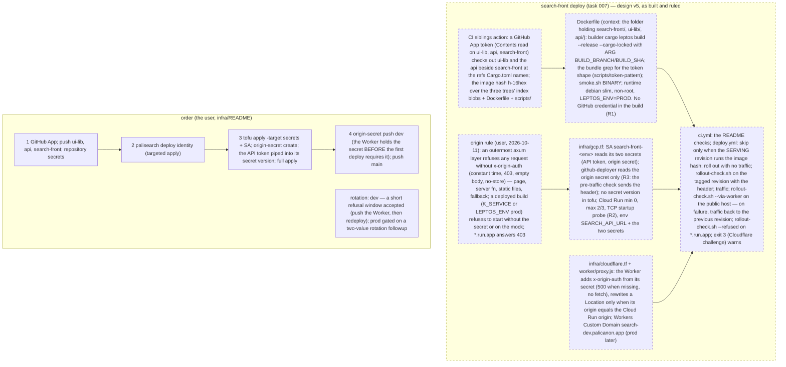

# 007 search-front deployed — search-dev.palicanon.app, then search.palicanon.app

status: user check · rank: 5 · level: hard · type: infra · request: user, 2026-10-11 ("non c'est sur search.palicanon.app" — test there, not locally) · session: search-front-007-deploy · process: ../../docs/workflows/development-process.mmd · after: [001]

## Summary
Rank (rank.md): difficulty 4 (learn-pali's deploy is a working model — infra in its own tofu state, a Worker per host, a content-addressed image, CI rollout — copied; new: the API token as a Cloud Run secret, a git dependency on two private repositories in the image build), impact 6 (public hosts; a token that spends the API; prod later) → 5. Level hard: secrets and infra.
Copy learn-pali's model (`learn-pali/infra`, `.github/workflows/deploy.yml`, `infra/worker/proxy.js`): its own tofu state (prefix `search-front`), a runtime service account `search-front-<env>` with one role: read its secret; Cloud Run `search-front-<env>` (europe-west1, min 0, max 2/3, startup probe on `/`); the env vars `SEARCH_API_URL` (`https://api-dev.palicanon.app` / `https://api.palicanon.app`) and `SEARCH_API_TOKEN` from Secret Manager (`search-front-api-token-<env>`, the value set by the user, never in tofu); a Worker relaying to Cloud Run with a Workers Custom Domain per host: `search-dev.palicanon.app` (dev — one level, in Universal SSL) and `search.palicanon.app` (prod, added later, as learn-pali's order: dev first); the image: a Dockerfile building the SSR binary + `target/site` with `cargo leptos build --release`, tag `h-<hash of inputs>`; CI `deploy.yml`: main → dev, tag `v*` → prod, rollout with no traffic, check (health, a real search, the token absent from the page — `scripts/check-wasm-no-token.sh`), then traffic; `ci.yml` with the README's checks. The private dependencies on a runner: ui-lib by git tag (048) or branch main, the API's client by git — both pushed first; the runner fetches them with a GitHub App token (Contents: read on ui-lib, api, search-front; design v3 — replaces the deploy keys). The deploy identity: `PaliCanon/search-front` added to the workload identity (palisearch `infra/gcp.tf`, as 3091ab1 did for learn-pali).
Only the user: an API site token for search-front (dev, then prod: `scripts/token` in the API repo, the hash in Secret Manager `pali-api-tokens-<env>`, the value into `search-front-api-token-<env>` and the keychain); the Cloudflare token in the keychain (`palicanon` / `cloudflare-api-token`) for `tofu apply`; the deploy keys; pushing ui-lib and the API; the first `tofu apply`.
Before: 001 (the v1 front with the real search) merged on search-front main; the phone short-page point of 001 ruled.

Origin rule (v4, user 2026-10-11): the service refuses any request without the Worker's `x-origin-auth` secret (constant-time compare, 403); the secret in Secret Manager `search-front-origin-secret-<env>` (env `ORIGIN_SECRET`) and in the Worker's secrets set through the Cloudflare API; rollout: the Worker sends it first, then the service requires it; `*.run.app` answers 403.

## Workflow

## Log
| Step | Result | Output |
| --- | --- | --- |
| Define | doing | orchestrator, 2026-10-11: task opened on `feat/deploy` (from `feat/v1-front`), worktree `wt/search-front-007-deploy`; the model is learn-pali's deploy |
| Define (consensus) | done | consensus agent, 2 rounds, design v3 (deep, gemini; sage silent): a GitHub App (Contents: read on ui-lib, api, search-front) replaces the deploy keys — token minted right before `docker build`, fed as a BuildKit secret through `url.insteadOf` (both URL forms), `CARGO_NET_GIT_FETCH_WITH_CLI`; the secret applied first (`-target`), the user adds its version, then the full apply (tofu owns env + secret ref, CI only the image); the image hash computed once after both checkouts, the Dockerfile and `scripts/` in it; the rollout greps `/` and `/?q=` for the token's shape (`scripts/token-pattern`, also used by the bundle grep); `git ls-remote` preflight. Known gap drawn: the public `*.run.app` origin bypasses Cloudflare — bounded in dev (max 2, a dedicated revocable token), prod gated on an origin-header followup. Open for the user: accept the dev gap or build the header now; create the GitHub App; the ordered commands |
| Define (user) | done | user, 2026-10-11: "les URLs publiques ne devraient accepter une requête que si elle est passée par Cloudflare" — design v4: the origin secret header in 007 (an axum layer, 403 without `x-origin-auth`; Secret Manager + Worker secret; Worker first, then the service). The GitHub App stands (the user may prefer a PAT). api 005 opened for the API; learn-pali's is the other session's |
| Plan | done | lead (Sonnet), 2026-10-11: 7 slices (below). Probes quoted in the Lanes notes. Two of them contradict the validated wording and are asked as design changes (no credential in the image build; the startup probe cannot carry the origin header without putting the secret in tofu state); two more are rulings (the deployer reads the origin secret; the Worker's secret after a tofu re-upload). Nothing built |

## Design
Viewer: search-front-007-deploy/design (diagram `d112473357f7342`, head version 4), validated by the user 2026-10-11 (v3 consensus + the v4 origin rule).

## Lanes
Planned 2026-10-11 by the lead. Each slice: the test first (red, seen), then the code; no file is in two slices; the order is the dependency order (S1 and S3 are independent; S2 needs S1 and S3's scripts; S5 needs S2 and S3; S4 and S6 are independent of the app).

**Probes behind the plan** (toolchain `~/.rustup-pc`, scratch `.../scratchpad/007/`):
- P1 `cargo fetch --locked` and `cargo check --locked -p search_front --features ssr` in a context holding `search-front/`, `ui-lib/`, `api/` side by side, with an EMPTY `CARGO_HOME`, `GIT_SSH_COMMAND=/bin/false` and no network credential: exit 0, no `git/` directory created in `CARGO_HOME`. `Cargo.lock` holds 0 `git+` sources (the patched packages are recorded as path packages). So the image build fetches no private git source: the only credential is the checkout of the two siblings. (learn-pali's comment that Cargo fetches a patched git source holds only when its lock records a git source; it does not here.)
- P2 the load needs, in `api/`: `Cargo.toml`, `crates/*` (api-client, api-types, search-core, yuga-client) and `api/Cargo.toml` (the member `api`; its `src/` is not needed to load); in `ui-lib/`: what learn-pali copies (`Cargo.toml build.rs README.md build locales src style`). `cargo metadata --locked --offline` is exit 0 on exactly that set.
- P3 MSRV: `cargo +1.88 check --locked` fails: `palicanon-api-client`, `palicanon-api-types`, `search-core` require rustc 1.91 and `uuid` 1.89 (learn-pali's `msrv 1.88` job would be red here). The CI job is 1.91.
- P4 `tofu` 1.12.6 present (`init -backend=false`, `fmt`, `validate`, `providers schema` work); providers `cloudflare` 4.52.9 and `google` 6.50.0. The cloudflare provider's `cloudflare_workers_script` has NO `keep_bindings`; it has `secret_text_binding` and `cloudflare_workers_secret` (both put the value in tofu state). `node` v26 present, `actionlint`, `docker`, `shellcheck`, `hadolint` absent (the Dockerfile and the workflows are first run on the runner).
- P5 `subtle` is already in `Cargo.lock` (transitive): a direct dependency adds no crate. `K_SERVICE` is set by Cloud Run in every container (documented container contract); `cargo leptos watch` sets `LEPTOS_ENV=DEV`; the image sets `LEPTOS_ENV=PROD`.

| Slice | Files (none in two slices) | Test first (red) | Code |
| --- | --- | --- | --- |
| **S1 origin guard** | `app/src/origin.rs` (new), `app/src/lib.rs`, `app/src/boot.rs`, `app/src/router.rs`, `app/src/router/tests.rs`, `app/src/main.rs`, `app/tests/boot_process.rs`, `app/Cargo.toml` (+ `Cargo.lock`: `subtle` direct, optional under `ssr`) | in `router/tests.rs`, over the real router bound on a port: no header 403; wrong value 403; empty value 403; a prefix of the secret and a longer value 403; two `x-origin-auth` headers 403; the right one 200 (page) and 200 on the server function; `POST /api/search_passages` without the header is 403 with ZERO API calls (`MockApi`); `/pkg/…` and an unknown path are 403 without the header (no route probing); a 403 has an empty body, no `x-origin-auth` echoed, no secret and no token; pairs: guard x body limit (oversized body without the header is 403, with it 500 as today), guard x token (the right-header page holds neither the API token nor the origin secret). In `boot.rs` (table): `ORIGIN_SECRET` unset + neither deployed signal = no check (local); unset + `LEPTOS_ENV=PROD` (any case, `production` too) = `BootError::OriginRequired`; unset + `K_SERVICE` set = `OriginRequired`; blank = `Empty` even locally; set = checked; trimmed; the errors name the variable, never the value; the `Debug` of the secret is redacted. In `boot_process.rs` (the real binary): `LEPTOS_ENV=PROD` without the secret exits non-zero naming `ORIGIN_SECRET`; with it, no header 403 and header 200; one `origin: checked` line at boot, the secret in no line. | `OriginSecret` (redacted `Debug`, constant-time `matches` over `subtle::ConstantTimeEq`, a length difference answers false without comparing), `Origin::{Open,Checked}`, `Origin::from_lookup(lookup)` reading the deployed signals, the axum `from_fn_with_state` layer applied OUTERMOST in `router(options, source, origin)` (so main cannot forget it: the signature needs it), 403 with `cache-control: no-store`, empty body; `main.rs` logs `origin: checked` / `origin: open (local)`. |
| **S2 Dockerfile** | `Dockerfile` (repo root), `app/tests/image_context.rs` (new) | `image_context.rs`: (a) `Cargo.lock` holds no `source = "git+` (the property P1 rests on; seen red against a copy of the lock with one added); (b) the Dockerfile's `COPY` lines are replayed into a temp dir from the three siblings and `cargo metadata --locked --offline` loads it (skipped with a printed reason when `../ui-lib` or `../api` are absent); (c) the Dockerfile sets `LEPTOS_ENV=PROD`, runs as a non-root user, and holds no `ARG`/`ENV`/`--mount=type=secret` named like a token. | Multi-stage: `tools` (rust:1.98-bookworm, wasm32 target, `cargo-leptos` 0.3.11, `wasm-bindgen-cli` read from the lock, as learn-pali), `builder` (context = the folder holding `search-front/ ui-lib/ api/`; COPY exactly the P2 set; a RUN that fails when the lock holds a git source; `cargo leptos build --release --cargo-locked`; `scripts/check-wasm-no-token.sh`), runtime (debian-slim, uid 10001, `LEPTOS_*` + `PORT=8080` env, `scripts/smoke.sh` as the last RUN with a throwaway `ORIGIN_SECRET` of its own). No BuildKit secret, no `insteadOf`, no `GIT_*`/`CARGO_NET_*` (pending ruling R1). |
| **S3 token pattern + scripts** | `scripts/token-pattern` (new), `scripts/check-wasm-no-token.sh`, `scripts/smoke.sh` (new), `scripts/rollout-check.sh` (new), `app/tests/check_wasm_script.rs`, `app/tests/site_scripts.rs` (new) | `check_wasm_script.rs`: a bundle holding `pc_dev_` + 43 base62 and one holding `pc_prod_…` fails; 42 characters or `pc_stage_` passes; the script reads the pattern from `scripts/token-pattern` (changing that file changes the verdict). `site_scripts.rs` (real binary + a fake server): `smoke.sh` passes on the mock with the right secret and fails (names the check) when `/` is not 200, when no header is 403-less, when the wasm is not served; `rollout-check.sh URL HEADER_FILE`: passes on the mock; fails when `/` or `/?q=` body OR HEADERS hold the token shape (a fake server planting it, once in a header); fails when the guard is off (a request without the header answers 200); the header file path never appears in the output, the header value neither. | `scripts/token-pattern` = `pc_(dev|prod)_[0-9A-Za-z]{43}` (one line, documented as the shape `api/scripts/token` issues); `check-wasm-no-token.sh` additionally `grep -aEq` it; `smoke.sh` (bash `/dev/tcp`, no curl in the image); `rollout-check.sh` (curl: `/` 200 and `PaliCanon — Search`, the hashed `.wasm` served, `/?q=satipatthana` 200 with the result list, no token shape in bodies and headers, no header = 403, `-H @file` so the secret is on no command line). |
| **S4 infra (tofu + Worker)** | `infra/{versions,variables,gcp,cloudflare,outputs}.tf`, `infra/.terraform.lock.hcl`, `infra/prod.tfvars.example`, `infra/worker/proxy.js`, `infra/worker/proxy.test.mjs` (new), `infra/scripts/origin-secret` (new), `infra/scripts/origin-secret.test.sh` (new), `infra/README.md`, `.gitignore` | `proxy.test.mjs` (`node --test`): the Worker sets `x-origin-auth` from `env.ORIGIN_AUTH` on every relayed request; overwrites one sent by the client; answers 500 WITHOUT calling `fetch` when the binding is absent or blank (a dropped secret is loud, not a silent 403 storm); still deletes `host`, sets `x-forwarded-host`, rewrites a `Location` to the `*.run.app` origin, relays the body of a POST. `origin-secret.test.sh` (stub `gcloud` and `curl` first on `PATH`, which log their argv and stdin): `create` generates 32 random bytes and adds ONE secret version through stdin, and does nothing when a version exists; `push` reads the latest version and PUTs it to the Worker through `curl --config -`; the value appears in no argv, in no printed line; `check` prints only OK/not OK. `tofu fmt -check`, `tofu init -backend=false` + `tofu validate`. | Copied from learn-pali, with: state prefix `search-front`; `envs` = dev only (`search-dev.palicanon.app`, max 2, `api_url`), prod commented (`search.palicanon.app`, max 3); two secrets per env, `search-front-api-token-<env>` and `search-front-origin-secret-<env>`, NO version in tofu; the runtime SA `search-front-<env>` with `secretAccessor` on those two only; Cloud Run 512Mi, min 0, env `SEARCH_API_URL` (value), `SEARCH_API_TOKEN` and `ORIGIN_SECRET` (`value_source.secret_key_ref`, `latest`), `LEPTOS_*` stay the image's; startup probe TCP 8080 (pending R2); tofu owns the service except image/scaling/client; Worker `search-front-<env>` with `ORIGIN` plain binding and NO secret binding in tofu (R4); Workers Custom Domain per host; `deployer_acts_as`; `infra/README.md` with the ordered commands (R3). |
| **S5 CI** | `.github/workflows/ci.yml`, `.github/workflows/deploy.yml`, `.github/actions/siblings/action.yml` (new), `scripts/image-hash.sh` (new), `app/tests/image_hash_script.rs` (new), `Cargo.toml` (`rust-version = "1.91"`), `README.md` | `image_hash_script.rs` (three temp git repos): same inputs, same hash; a changed `app/` file, `Dockerfile`, `scripts/` file, `Cargo.lock`, the ui-lib HEAD or the api HEAD each change it; a file outside the inputs (`infra/`, `.task/`, `README.md`) does not; hash is `h-` + 16 hex. Workflows: parsed as YAML (python) and checked by a script for the rules the design names (see Verify): no secret in a `run:` line, `permissions` minimal, a `concurrency` group per env, the traffic update after the check step. | `siblings` composite (mint the App token with `actions/create-github-app-token`, checkout `PaliCanon/ui-lib` and `PaliCanon/api` beside, `persist-credentials: false`, `test -f api/crates/api-client/Cargo.toml` preflight); `ci.yml` = the README checks (fmt, leptosfmt, clippy ssr + hydrate wasm, test, doc, msrv 1.91, coverage, and a `bundle` job: `cargo leptos build` + `check-wasm-no-token.sh`); `deploy.yml` = one job: checkout, siblings, WIF auth, `image-hash.sh` once, exists?, build-push (no secret), `gcloud run deploy --no-traffic --tag`, read the origin secret from Secret Manager into a `0600` header file, `rollout-check.sh` on the tagged URL, traffic, then `rollout-check.sh` through the Worker host and the bare `*.run.app` URL answering 403. |
| **S6 deploy identity (palisearch)** | `/Users/lsh/projects/palisearch/infra/variables.tf` only, on branch `infra/search-front-deploy-identity` (own commit, as 3091ab1) | `tofu fmt -check` and `tofu validate` on palisearch `infra` (backend off) before and after; the diff is one list entry. | `PaliCanon/search-front` appended to `github_repos`. The message does not say "applied": only the user applies. |
| **S7 (optional, ruling R5)** | `app/build.rs`, `app/src/git_info.rs`, `Dockerfile` (one `ARG`), `deploy.yml` (two build args) | `git_info.rs`: branch and sha from `SEARCH_FRONT_GIT_BRANCH`/`_COMMIT` win over git; one alone is ignored; blank is ignored. | The footer badge on dev/prod shows the branch and the commit instead of `unknown` (the image has no `.git`). |

**Overlaps.** `git branch --list` in search-front: `feat/v1-front` (001, the base of this branch; `feat/deploy` differs from it by `.task/` files only) and `main`. 007 is stacked on 001: S1 touches `main.rs`, `boot.rs`, `router.rs`, `router/tests.rs`, `README.md`, `Cargo.toml` that 001 owns — any further commit on `feat/v1-front` there conflicts with S1/S5; the rebase on `main` comes after 001's merge. palisearch: no open `feat/*` or `infra/*` branch; `infra/variables.tf` is untouched elsewhere. ui-lib and the api: this task changes nothing in them; it needs both pushed (ui-lib 28 ahead, api 5 ahead, the client commits among them).

## Rulings asked (the plan is written for the recommended answer)
- **R1 (design change, v3 node `deps`/`img`)**: P1 shows the image build needs NO GitHub credential once the two siblings are COPYed (the lock has no git source). Recommended: drop the BuildKit secret, the `insteadOf` pair, `GIT_SSH_COMMAND`, `CARGO_NET_GIT_FETCH_WITH_CLI`, the second token mint, the `CARGO_HOME` grep and the `ls-remote` preflight (the checkout step already fails on a missing repo or access); the App token then lives only in the checkout steps (a stronger form of "nothing in a layer or the gha cache"), and a test pins the property (`Cargo.lock` has no git source). If refused, S2/S5 add the v3 pieces unchanged.
- **R2 (design change, node `origin`: "the startup probe included: it is sent with the header")**: a Cloud Run HTTP probe header is a plain string in the service resource, so the origin secret would sit in tofu state and in the revision JSON (anyone with `run.viewer`). Recommended: a TCP startup probe on 8080; the HTTP check of `/` moves to the rollout (no traffic yet, header from Secret Manager). Alternative: an unauthenticated `/_ready` exempt from the guard (one more public route, one more test).
- **R3 (new IAM, not in the design)**: the pre-traffic check of the tagged revision needs the header, so `github-deployer` gets `secretAccessor` on `search-front-origin-secret-<env>` only (tofu in search-front). Consequence: any repository listed in `github_repos` can read that one secret. Alternative: check only through the Worker host after traffic (no pre-traffic proof of the new revision).
- **R4 (operational hazard)**: the provider has no `keep_bindings`, so a `tofu apply` that changes `worker/proxy.js` re-uploads the script and (Cloudflare: bindings are replaced on upload unless kept) drops the secret set through the API. I could not probe it (it needs a Cloudflare write). Plan: the Worker answers 500 when its secret is missing; `origin-secret push <env>` is re-run after any apply that touches the Worker (README rule); the post-traffic check through the Worker host catches a drop. Alternative: `cloudflare_workers_secret` (the value lands in tofu state: breaks the v4 rule).
- **R5 (outside the design, small)**: (a) S7, the badge; (b) a deployed build (`LEPTOS_ENV=PROD`) refuses to start on the MOCK source too (today neither variable = a public site serving four fixed hits, silently); I recommend (b) inside S1 (one more table row) and S7 as a separate commit; both need a yes.
- **R6 (risk)**: the post-traffic check from a GitHub runner to `search-dev.palicanon.app` can meet Cloudflare Bot Fight / a managed challenge (403 with `cf-mitigated: challenge`). The script tells it from our 403 (empty body, no `cf-mitigated`); if it happens, the user decides a WAF skip rule for the runner or drops that one check.

## Only the user, in order (dev; prod repeats 5-10 later with its own token and secrets)
1. Create the GitHub App in the PaliCanon organisation (permission: Contents read), install it on `ui-lib`, `api` and `search-front` (fallback: a fine-grained PAT of a machine user, same three repositories).
2. Push `ui-lib` main (28 commits ahead), `api` main (5 ahead; the API client is in them), and `search-front` (001 merged first, then this task). Repository secrets on `search-front`: `APP_ID`, `APP_PRIVATE_KEY`; repository variables `WIF_PROVIDER`, `DEPLOYER_SA`, `GCP_PROJECT` (as learn-pali's).
3. palisearch: merge `infra/search-front-deploy-identity`, then the targeted apply of the WIF provider's `attribute_condition` and `google_service_account_iam_member.deployer_wif["PaliCanon/search-front"]`.
4. `gcloud auth application-default login`; `export CLOUDFLARE_API_TOKEN=$(security find-generic-password -a palicanon -s cloudflare-api-token -w)`.
5. In `search-front/infra`: `tofu init`, then `tofu apply` targeted at the two secrets, the runtime service account and its IAM members (the exact `-target` list is in `infra/README.md`).
6. `infra/scripts/origin-secret create dev` (generates the origin secret and stores it in Secret Manager; prints nothing secret).
7. In the API repo: `scripts/token new search-front --env dev | gcloud secrets versions add search-front-api-token-dev --project palicanon-app --data-file=-` (the value is never typed, shown or saved elsewhere).
8. `tofu apply` (the rest: Cloud Run on the placeholder image, the Worker, the Custom Domain).
9. `infra/scripts/origin-secret push dev` (the Worker gets the secret); `infra/scripts/origin-secret check dev` says OK.
10. Push `search-front` main: `deploy.yml` rolls dev; look at https://search-dev.palicanon.app.
Rotation of either secret = a new version, then a new revision (the value is read when an instance starts), and `push` again for the origin secret; a few seconds of 403 are expected (no two-value overlap in v1).

## Reviews
| Plan | done | lead (Sonnet): f1ef4d0 — S1 origin guard (boot + outermost axum layer, `subtle`, deployed = `LEPTOS_ENV` prod or `K_SERVICE`), S2 Dockerfile, S3 scripts (token-pattern, smoke, rollout-check), S4 infra from learn-pali (+ `origin-secret` script), S5 CI + composite `siblings` action + image-hash, S6 palisearch deploy identity, S7 badge from env. Rulings: R1 no credential in the image build; R2 TCP probe; R3 deployer reads the origin secret only; R4 mitigations; R5 badge yes + prod refuses the mock; R6 noted; MSRV 1.91 |
| Build | done | lane A (Sonnet): 7873ac0 origin guard, 0dfaba9 scripts, e6d0e17 prod refuses the mock, e962e61 badge from env; lane B (Sonnet, sibling branch, cherry-picked): a2bb8b3 Dockerfile, e89b1d5 infra, 45167b1 CI; palisearch e58cc48 on `infra/search-front-deploy-identity` (not applied); integration lane: 293bde1 build args + smoke call, 5ada690 the unneeded api COPY dropped, ab4e71f rust-version inherited, cb8972a deploy.yml on the scripts' real interfaces. Accepted: the retry loop on the public check; the badge of a reused image keeps the commit it was built from (the image is content-addressed) |
| Verify | done | orchestrator: on the branch tip — cargo tests all green, `tofu validate` Success, the workflow rules OK. Not runnable locally: docker, actionlint (first exercised on the runner). Reviewer (Opus) briefed |

## Reviews
### Round 1 — 2026-10-11
Review entry d70a544949b704f v1; diff #4833–#4858, design #4859–#4860, summons #4861; deep #4866. Design reissued as v5 (as built and ruled). Fixes: D7 compare the serving revision; D11 roll traffic back on a failed public check; W Location rewrite by origin + tests; G/R forbidden's empty body + no-store asserted. Ruled out: OFL (from_lookup in boot.rs, tested); rotation documented, prod gated on a two-value followup.
### Fix round 1
lane (Sonnet): c600b44 D7 (the serving revision's image), 541eb4f D11 (traffic back on a failed public check), 5f4b171 W (Location by origin; missing ORIGIN 500), 68c04a3 README (rotation, first-deploy order); items 4–5 already pinned (shown by mutation). 315 tests, 31 workflow rules, 15 Worker tests, 34 script tests, tofu valid. Left: the `infra/scripts/origin-secret` comment still states the reverse rotation order — next lane. Round 2 posted.
### Round 2 — 2026-10-11
Deep #4877 (sage silent): OFL ruled out (the origin table tests exist); fixes: the rollback's own failure printed, rollback only on a refusal (a Worker 500 names `origin-secret push`), `serving=` fallback to `latestRevision` and a loud failure when empty, D13 a non-refusing `*.run.app` rolls back, `originOf` requires https + the client header overwritten, `check_rollback` asserts the arm; the origin-secret comment.
### Fix round 2
lane (Sonnet): 0373731 check_rollback asserts the arm, a3ae4c6 the rollback no longer masks the exit code, 4a45ba1 rollback only on a refusal (exit 4 = the Worker's own 500, remedy named), af64aa3 rollback when --refused fails, 09374c9 serving revision (scripts/serving-revision.sh, 12 cases, latestReadyRevisionName fallback, empty → error), 8bf5794 originOf https, 9cd958d origin-secret comment, 390957d docstring. 317 Rust, 55 rules, 17 Worker, 59 script tests; tofu valid; the public-host step simulated with stubs. Round 3 posted.
### Round 3 — 2026-10-11
Deep #4892: the round-2 rulings implemented correctly; findings: D13 rollback restores nothing (boot config — the orchestrator's round-2 ruling reversed: fail with the remedy, no rollback), the rollback's outcome its own exit 5, the Worker's public origin from a binding, the Worker-500 match normalised — Fix round 3; deferred to the first deploy: a real describe fixture; followup: rotation before traffic. Rounds spent: no fourth voice round.
### Fix round 3
lane (Sonnet): 8d50cec a bare origin that answers fails without rollback, 31b07f5 the rollback read back (exit 5), 3bd00f5 the Worker's public origin from PUBLIC_ORIGIN, 75d8b5e the Worker-500 match normalised. Orchestrator's check: 319 Rust tests, 0 workflow violations, Worker tests, tofu valid. The rounds are spent; the Check is the first dev deploy, run by the user's ordered actions (infra/README "Only the user, in order").
| User actions 1-9 (dev) | done | 2026-10-13, user: "deploy le search", the GitHub App created by the user (palicanon-ci, id 5297186, installed on the org selection; APP_PRIVATE_KEY set by the user, the .pem deleted); orchestrator: APP_ID and the three variables (copied from learn-pali); ui-lib main + v0.1.1 and api main pushed; palisearch 94e6761 (identity, cherry-picked) applied, targeted: 1 change, 1 add; infra step 5: 7 added; origin secret v1 created; API token issued straight into search-front-api-token-dev v1 (api-dev rolled a revision); full apply: 4 added (Cloud Run on the hello image, Worker, iam public, custom domain search-dev.palicanon.app); origin-secret push then check: OK; https://search-dev.palicanon.app 200 (placeholder). The Cloudflare token is under keychain account `lsh`, not `palicanon` (claude-memory/secrets.md fixed). Bug: `origin-secret push` reports a failure on HTTP 201 though the write succeeded (check OK) — opened as 014. |
