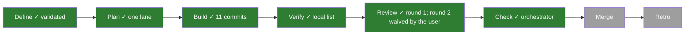

# 021 Search runs inside the PaliCanon app

status: review · rank: 7 · level: hard · type: feature · request: app-001-palicanon-app T8 (user, 2026-10-16: "occupe toi du search alors"; "Tout en local") · session: search-front-021-app-fragment · after: [020] · ui-lib: v0.3.0

## Summary
Rank (rank.md): difficulty 7 (a new build mode around a page that renders SsrMode::Async through a server fn, the shell split from the screens, a backend abstraction with a new outcome, a token that must stay server-only), impact 7 (search.palicanon.app's every search, and the app's Search) → 7.
Why: the PaliCanon app (Tauri, client side, offline) mounts Search under /search in its own AppShell beside Learn and the Map, and searches with local yuga only, never the network (decision 2026-10-16). The preview showed the live site in a frame: a double rail, the old palette.
Today: SearchPage's fetch() calls the server fn search_passages; on the server a SearchSource reaches the API with a token; the route is SsrMode::Async; the site's shell, footer pages and origin guard live in app.rs and router.
Design v1 (mirrors learn-pali 048): a csr feature; a public Search fragment (SearchRoutes under the parent's base, SearchProvider with a required backend) without shell or footer pages; a SearchBackend trait: the site plugs today's server fn, the app plugs local yuga (T5b); a new outcome Unavailable for a mode the app cannot serve (meaning without the model); read links stay plain https links, the app opens them outside.

## Workflow

## Log
| Step | Result | Output |
| --- | --- | --- |
| Define | doing | orchestrator (learn-pali session), 2026-10-16: session search-front-021-app-fragment (design d15a1fc68949346 v1, discussion d66316c90df5241, process db5977a06f09e41); worktree /Users/lsh/projects/palicanon/wt/sf021/search-front (feat/app-fragment), ui-lib worktree /Users/lsh/projects/palicanon/wt/sf021/ui-lib at v0.3.0 |
| Define (consensus) | done | consensus agent (Opus), 3 rounds, v4: server fn and site backend under ssr or hydrate only; SearchBackend Send + Sync, boxed Send future, meaning() signal read once (no Unavailable outcome); csr submit navigates in place; the mode kept in links; a cargo tree + wasm grep guard that csr holds no token path |
| Define (user) | — | 2026-10-16: the mode dropdown is hidden while meaning is unavailable («Masqué», as v4 draws); the home keeps all three badges in the app («Garder les trois»: no host prop); the desktop model: «on devrait peut-être utiliser un modèle plus petit» → a model study (app task), outside 021 |
| Define (user) | done | user, 2026-10-16: «Oui, construis 048 + 021» — the design validated |
| Plan | done | orchestrator: one Sonnet lane (the fragment, the backend/store trait and the site's rewiring share app.rs and the page: not separable without a file in two lanes), committed in steps, test first; heavy builds throttled (nice, -j 4: two tasks build in parallel on the user's machine); the router question settled by the first red test |
| Build | done | lane:fragment (Sonnet): 2459166 router probe … 26d8981 (11 commits, rebased on e5fa0da). Router: ParentRoute /search + path!("") matches /search, /search/, ?q=; use_matched() "/search" (root ""), no fallback. Checks all exit 0 (fmt, leptosfmt, clippy ssr/hydrate/csr lib+all-targets, tests ssr 380 (lib 308), doc, leptos build, check-wasm-no-token, csr browser 7 + mount 1, BUNDLE_MODE=csr (bites on the site bundle), infra scripts and tofu fmt). Not run: MSRV 1.91, coverage, tofu validate, image build. Document diff of / and /?q=mn10 main vs branch: identical (nonce and badge normalised) |
| Rulings | done | orchestrator: (1) csr red on two intermediate commits — accepted (squash merge; green from 3295fc4); (2) the superseded answer is shown dimmed then replaced (Leptos runs a Resource's fetches in order) — accepted, design wording changed (v5, viewer and here); (3) a submit keeps the fields the form lacks from the URL (6cb28c5) — accepted, in v5; (4) web-sys for csr, wasm-bindgen-test dev deps — accepted; (5) the private `site` feature, csr::mount in its own test file, harness changes — accepted. MSRV 1.91 and coverage run before the merge (local list, user rule) |
| Review 1 | fail | reviewer: de8613f2150614a v2; deep 9762/9786/9803/9823 (Δ and T in every part, two real behaviour gaps), sage 9842/9855/9870/9885 (thin). Rulings in ### Round 1; Fix round 1 |
| Fix 1 | done | lane:fragment: 0e6a041 G1 (retry asks again; the bump only for the search already shown), 216f567 G2 (kept fields, defaults not written, one builder), 819c07d G3, ea5e2fa G4, 5a2c9e0 + 054df92 G5; red or mutation per item. Local list at 054df92 all exit 0 incl. MSRV 1.91.1 check and both csr bundle checks; tests ssr 386 (lib 314), browser 13 + 1. Coverage (llvm-cov, ssr): lines 98.83% (main 98.79%), regions 98.43% (98.38%), functions 98.89% (99.00%). Rulings: the site's retry links lose their default `c=all&mode=both` (defaults not written) — accepted; functions −0.11 point with lines and regions up — accepted (the csr paths are covered by the browser tests, not counted in the ssr run) |
| Paused | — | 2026-10-16: the user stopped this task's running agent and set the Map first («commence par intégrer la carte»); resumes from this row |
| Build (vendor) | done | a1628e2: placeholders.rs vendored into app/build (until ui-lib 068), so the crate builds from a git checkout; build and tests exit 0 (314) |
| Rule (user) | — | 2026-10-16: «Fusionner sans dernier tour» — merged without review round 2; the round runs after the merge and its findings become a follow-up task |
| Check | done | orchestrator: the Fix 1 local list (all exit 0, MSRV 1.91.1, coverage lines 98.83%) plus a1628e2's build and tests; the site's documents identical (build) but for shorter retry links |

## Design
Viewer: search-front-021-app-fragment/design (d15a1fc68949346), v5 — v4 validated by the user 2026-10-16, v5 = two wordings ruled on the build (the superseded answer; a submit keeps the asked fields).

```mermaid
flowchart TB
  subgraph t8["search-front 021 — Search runs inside the PaliCanon app (T8 of app-001 v7) — the site unchanged"]
    feat["features of the app crate (search_front): ssr and hydrate unchanged for the site; a new csr = leptos/csr + palicanon-ui-lib/csr (v0.3.0, after 020) + a private browser feature (hydrate OR csr, as ui-lib 067) that takes every browser-only path today gated on hydrate: the focus shortcut, js-sys (the browser clock of the verse of the day), wasm-bindgen; the server fn module search::server and the site backend compiled under ssr OR hydrate only (hydrate keeps the client stub its refetches need), never under csr alone: the csr build has no search_passages, no /api/ endpoint string, no API client, no token; the site's server (main.rs, axum, boot, origin guard, router) only under ssr. ssr and hydrate never build together in this repository (ci.yml: no --all-features, a clippy matrix per feature): csr joins that matrix as a third entry, alone on wasm32; no compile_error!, csr alone is proven by its own build (tests e)"]
    frag["the Search fragment, public, mirrors learn-pali 048: SearchRoutes (#[component(transparent)], one relative route path!(''), the search page: home while ?q= is blank, results otherwise, ssr=SsrMode::Async kept for the site, inert in csr) that the PARENT mounts, the site at the root, the app inside ParentRoute /search; SearchProvider (props: backend, required, no default: a default in the app would be a call to an origin that is not a server) puts it in context. Its base is never a prop: every link is built from use_matched() of its route (the brand, Examples ?q=, the verse's ?passage=, the retry href), so /search?q=… in the app and /?q=… on the site. Its URL is its public contract: ?q= ?c= ?mode= ?passage= (the Map links to /search?q=<uid>). Submit: under csr the fragment's root holds one on:submit that prevents the document load and navigates (use_navigate) to the href built from the form's FormData (q, and c and mode, which the results page's dropdowns join through form=) on the matched base, by the ONE href builder the links use; form.request_submit() of the dropdowns fires the same event; the site (ssr, hydrate) keeps its document GET. The focus shortcut keeps its listener handle and removes it on_cleanup (today dropped: it stacks on every remount and outlives the page). No AppShell, no rail, no footer, no footer pages (Acknowledgements, Terms, Privacy, Support stay the site's routes), no Title. The home's content is compiled in (VERSES, the examples pool) and its clock is the browser's (js-sys under browser): it needs no backend and no network. Hidden dependencies, in its rustdoc and each tested: the one language signal (provide_language), root-served assets (/lotus.png, /brand/*.svg), one SearchProvider per page (SEARCH_FORM_ID), a ui-lib tag equal to the host's, the host opens target=_blank and external links outside the window"]
    backend["SearchBackend: Send + Sync + 'static, required by SearchProvider. search(SearchQuery) -> Pin Box dyn Future Output = SearchOutcome + Send, 'static: SearchQuery is today's SearchKey made public (q trimmed, lang, mode, collection); no ServerFnError in the signature (each impl maps its own failures to Failed). meaning() -> Signal<bool>: whether Meaning and Both can be served now (Words always can; the only two states anywhere); the impl creates that signal once at construction and returns the same Copy handle on every call, and SearchProvider reads it once at mount into context. SearchOutcome unchanged: Hits, Cold, RateLimited, Failed (no new variant: the site's exhaustive matches, the wire and response.rs stay as they are). Site impl = today's server fn search_passages (SSR: a direct call; hydrate: the HTTP call), Err mapped to Failed, meaning() a constant true. App impl (T5b) = local yuga through a Tauri command, its !Send JsFuture wrapped in SendWrapper inside the impl, never the network (decision 2026-10-16, «Tout en local»); meaning() from search_status: false until the model is there (desktop), false for ever on mobile; the sidecar starting is Cold (the existing 'waking up' state, retry link)"]
    modes["modes against meaning(): SearchKey keeps the mode ASKED (?mode=, Both by default): it builds every href (links, retry, submit), so a downgrade never rewrites a shareable URL; the SearchQuery handed to the backend carries the mode RESOLVED: the asked one when meaning() is true, Words otherwise. The Resource is keyed on the resolved query, so the model arriving re-asks the same search as Both; Leptos 0.8 runs a Resource's fetches one after the other, so a pending Words answer lands first, shown dimmed by the page's pending rule, then the Both answer replaces it: a stale answer never overwrites a fresher one (ruled 2026-10-16 on the build). A submit keeps for each field the form lacks what the URL asked (no dropdown: ?mode= is kept). The mode dropdown is not rendered while meaning() is false (nothing to choose; user question open: hidden, or shown with Meaning and Both disabled and a line, deep's choice: a ?mode=meaning link is then visible as asked) and appears when it turns true. The backend is never asked Meaning or Both while its meaning() is false; if it is (a race), it searches Words and the page shows the hits, never an error"]
    links["read links (suttacentral.net hits with target=_blank, the verse of the day's source): plain https links; the app opens them in the system browser (its opener, app-001 T5a), the fragment does nothing special"]
    site["the site keeps its shell: App = Router + SearchProvider(site backend) around AppShell(nav, footer) with SearchRoutes at / and its footer pages beside, its own Title; its SSR document, the hydration root, response.rs statuses, the origin guard and tests unchanged; its form stays a document GET"]
    tests["tests: (a) the site's SSR and router tests pass unchanged (generate_route_list still lists / as SsrMode::Async), and in Verify the rendered / and /?q=mn10 documents are diffed main vs branch (badge sha normalised), the result in the Log; (b) native tests of the fragment under ParentRoute /search: /search and /search?q= render the home and the results, the brand, example, passage and retry links carry /search, the same fragment at the root keeps /; (c) a fake SearchBackend drives Hits, Cold, RateLimited and Failed through the page, and its meaning(): false, no mode dropdown, ?mode=both asked as Words and the retry href still says mode=both; true, the dropdown and Both asked; flipped to true while the Words query is pending, Both is asked and the Words answer that lands after it is not shown; (d) browser tests (wasm-bindgen-test, headless Chrome, as ui-lib tests/csr.rs), SearchRoutes under /search by csr::mount with a fake backend: the home renders its verse of the day; '/' focuses the field (the browser feature's shortcut observed, the same cfg hydrate compiles); a query typed and submitted navigates to /search?q=… with no document load (a window marker survives), the fake saw it, the hits shown; a dropdown choice the same; Search unmounted (navigate to a sibling route), '/' and Cmd-K are not prevented and nothing panics; (e) CI: the clippy matrix gains csr (-p search_front --lib --no-default-features --features csr --target wasm32-unknown-unknown) beside ssr and hydrate, which keep building the browser feature's paths under hydrate; cargo tree -e normal --target wasm32-unknown-unknown of the csr build holds none of palicanon-api-client, axum, leptos_axum, tokio, subtle; the csr build's wasm-bindgen output passes scripts/check-wasm-no-token.sh (PKG_DIR) with one more needle for csr only, '/api/search_passages' (the hydrate bundle legitimately holds it)"]
  end
  app["PaliCanon app (T5a/T5b): SearchProvider(its yuga backend) and SearchRoutes inside ParentRoute /search, one rail with Learn, Search, Map; desktop keywords until the model is there, then both; mobile keywords only; serves /lotus.png and /brand/*.svg at its root; external links to the system browser"]
  ui["ui-lib v0.3.0 (020: search-front moves to it): csr, csr::mount, the cream palette; SearchCard and SearchRow unchanged"]
  ui --> feat
  feat --> frag --> app
  frag --> site
  backend --> frag
  backend --> modes --> frag
  backend -.-> app
  links -.-> frag
  tests -.-> frag
```

## Lanes

## Reviews

### Round 1 — 2026-10-16
Voices: deep (9762, 9786, 9803, 9823), sage (9842, 9855, 9870, 9885). Rulings (orchestrator), taken in:
- G1 a terminal state has a way out (deep 9823): after Failed (or Cold, RateLimited), resubmitting the same query or following Retry asks the backend again (the Resource keyed on a retry counter or equivalent), test: Failed, identical resubmit, the backend asked twice, the hits shown.
- G2 the kept fields (deep 9803): a csr submit keeps every field the form lacks from the URL, `?passage=` included; a field equal to its default is not written (no `mode=both` added when the URL had none); one builder: `form_href` and `SearchKey::href` give the same string for the same inputs (a table test, `?passage=` and `?c=` included).
- G3 the bundle checks (deep 9762): CI runs check-wasm-no-token.sh with BUNDLE_MODE=csr on both csr test bundles (csr and csr_mount); an empty or unknown BUNDLE_MODE is an error, not the site (test); the wasm-bindgen version step fails loudly when its version is empty. The app's own bundle is checked by the app (T5a), noted.
- G4 cleanups (deep 9823): the comment in tests/csr.rs matches what `leave()` does; a test: two hosts mounted, one left, one `/` press focuses once and nothing panics.
- G5 tests (deep, sage): a blank or whitespace `q` at /search never reaches the backend; a zero-hit Hits renders the no-result state; Examples and the daily passage links carry /search at that base; `meaning` flipped on after the first paint, then off again (the dropdown follows, the asked mode kept); the doc of `Provided.meaning` says what the code does (tracked, not "as at mount").
Ruled out: `--all-targets` for csr clippy (a superset, ruled at the build); `Base::fixed` for the footer pages (they live at the root, outside the fragment); the provider `expect` panic (documented, as learn-pali 048); the ask/resolve rule's location (internal); a Words answer landing after Both (Leptos runs a Resource's fetches in order: unreachable); `/` typed while the field is focused (the browser's own behaviour).

## Merge
