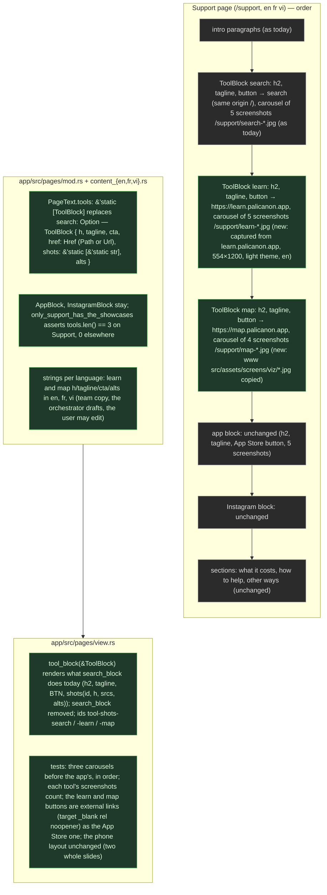

# 022 Support page: the tools to discover the Canon (search, learn, map)

status: design · rank: 5 · level: standard · type: feature · after: [021] · session: search-front-022-support-tools · process: ../../docs/workflows/development-process.mmd

## Summary
Rank: difficulty 4 (three showcase blocks on one page, content in three languages, screenshots and carousels reused from ui-lib's Carousel; the learn and map screenshots exist in www's design task), impact 5 (the Support page is linked from every page's footer) → 5. Orchestrator: a Sonnet lead; design on Opus.
Request (user, 2026-10-16): "Il faudrait aussi mettre à jour la page support pour présenter les différents tools pour découvrir le palicanon. … ça doit être search / learn / map." Today `app/src/pages/content_{en,fr,vi}.rs` `support` holds a search showcase (five screenshots, `app/public/support/search-*.jpg`), the Tipiṭaka app's (five, `app-*.jpg`), the Instagram block, then the sections (what it costs, Ko-fi, other ways to help); `app/src/pages/view.rs` renders the showcases with `palicanon_ui_lib::Carousel` (search first, then the app: 010).
To design: the three tools in order — the search (search.palicanon.app), learning Pāli (learn.palicanon.app), the map (map.palicanon.app) — each a showcase block (heading, one tagline, a button to the service, a carousel of screenshots); whether the app's block and the Instagram block stay (open, the user decides); the screenshots for learn and map (www 004 captured both: `www/src/assets/screens/{viz,learn}/`; learn's from learn.dev); the strings in the three languages; the `SearchBlock`/`AppBlock` structs generalised into one `ToolBlock` (a list in order) rather than a third optional field.
Ruled (user, 2026-10-16: "un pour chaque site, comme pour l'app mobile avec un carrousel"): one block per tool (search, learn, map), each like the app's block (heading, tagline, button, carousel of screenshots); the app block and Instagram stay; order: search, learn, map, the app, Instagram, then the sections. Learn's screenshots are captured from learn.palicanon.app (five, 554×1200, light theme, en); the map's are www's four captures (`www/src/assets/screens/viz/`). Fast path (no new architecture): design v1 below, validated by the user's ruling. Build waits for 021 (feat/app-fragment touches `app/src/pages/view.rs`).

## Log
| Step | Result | Output |
| --- | --- | --- |
| Define | done | orchestrator, 2026-10-16: the need posted (#10060), the user ruled one block per tool like the app's; design v1 dd5123093cbdb4a |

## Design
Viewer: search-front-022-support-tools/design v1 (dd5123093cbdb4a), 2026-10-16, from the user's ruling.

