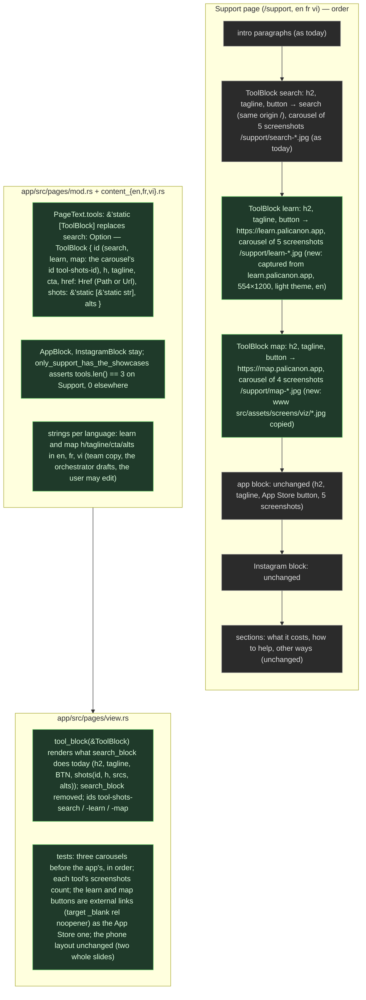

# 022 Support page: the tools to discover the Canon (search, learn, map)

status: merging · rank: 5 · level: standard · type: feature · after: [] (021 paused, 022 first: process #10117) · session: search-front-022-support-tools · process: ../../docs/workflows/development-process.mmd

## Summary
Rank: difficulty 4 (three showcase blocks on one page, content in three languages, screenshots and carousels reused from ui-lib's Carousel; the learn and map screenshots exist in www's design task), impact 5 (the Support page is linked from every page's footer) → 5. Orchestrator: a Sonnet lead; design on Opus.
Request (user, 2026-10-16): "Il faudrait aussi mettre à jour la page support pour présenter les différents tools pour découvrir le palicanon. … ça doit être search / learn / map." Today `app/src/pages/content_{en,fr,vi}.rs` `support` holds a search showcase (five screenshots, `app/public/support/search-*.jpg`), the Tipiṭaka app's (five, `app-*.jpg`), the Instagram block, then the sections (what it costs, Ko-fi, other ways to help); `app/src/pages/view.rs` renders the showcases with `palicanon_ui_lib::Carousel` (search first, then the app: 010).
To design: the three tools in order — the search (search.palicanon.app), learning Pāli (learn.palicanon.app), the map (map.palicanon.app) — each a showcase block (heading, one tagline, a button to the service, a carousel of screenshots); whether the app's block and the Instagram block stay (open, the user decides); the screenshots for learn and map (www 004 captured both: `www/src/assets/screens/{viz,learn}/`; learn's from learn.dev); the strings in the three languages; the `SearchBlock`/`AppBlock` structs generalised into one `ToolBlock` (a list in order) rather than a third optional field.
Ruled (user, 2026-10-16: "un pour chaque site, comme pour l'app mobile avec un carrousel"): one block per tool (search, learn, map), each like the app's block (heading, tagline, button, carousel of screenshots); the app block and Instagram stay; order: search, learn, map, the app, Instagram, then the sections. Learn's screenshots are captured from learn.palicanon.app (five, 554×1200, light theme, en); the map's are www's four captures (`www/src/assets/screens/viz/`). Fast path (no new architecture): design v1 below, validated by the user's ruling. Build waits for 021 (feat/app-fragment touches `app/src/pages/view.rs`).

## Workflow

Define ✓ user ruling · Plan ✓ 3 slices, view waits for 021 · Data ✓ ToolBlock/Href/tools, 5 new tests · Assets ✓ 9 jpg 554x1200 · Verify ✓ 287 lib tests, clippy ssr+hydrate, fmt, leptosfmt, doc · View ✓ 290 lib tests, clippy ssr+hydrate, leptos build, wasm token check

## Log
| Step | Result | Output |
| --- | --- | --- |
| Define | done | orchestrator, 2026-10-16: the need posted (#10060), the user ruled one block per tool like the app's; design v1 dd5123093cbdb4a |
| Plan | done | lead, 2026-10-16: `a2m impact` on `search_block` and `shots` (callers: `Body`, `app_block`); `PageText`/`SearchBlock` are types, which a2m cannot resolve, so found by grep: `view.rs` (17, 142, 151-166, 583-585 and its tests), `content_{en,fr,vi}.rs`. Overlap with open branches: `feat/app-fragment` (021) touches `app/src/pages/view.rs` only; `feat/deploy` (007) touches none of ours. Three lanes below; lane 3 waits for 021. |
| Build 1+2 | done | lead, 2026-10-16: red first (8 `pages::tests` run, 6 failed on assertions with `tools: &[]` stubbed), then green. Commits e0947f2 (assets: learn-1..5 captured from learn.palicanon.app at 277x600 dpr 2, light, en: home, "New terms" dialog, a MEANING card, its answer with an example, a CONTEXT card; map-*.jpg copied from www), 9d64475 (ToolBlock, Href, `PageText.tools` beside `search`; `#[allow(dead_code)]` on the three items until the view reads them; five tests). Mutation: map-phone.jpg moved away fails `every_tool_shot_exists_at_554_by_1200`. |
| Verify | done | lead: `cargo fmt --check` 0, `leptosfmt --check .` 0, `cargo test --locked -p search_front --features ssr` 0 (287 lib tests, was 282; 356 `ok` lines over all targets), clippy ssr `--all-targets -D warnings` 0, clippy hydrate wasm32 `--lib` 0, `cargo doc` with `-D warnings` 0. Toolchain: rustc 1.99.0 from `~/.rustup-pc` (Homebrew's 1.98 has no wasm32 target; `~/.cargo/env` does not exist). ui-lib: tag v0.3.0 in `app/Cargo.toml`, built through the `[patch]` against the sibling `wt/ui-lib` = ui-lib 5647887 (v0.3.0 + 2); `Cargo.lock` untouched. `cargo leptos build` and the wasm token check are not run: the view is untouched. |
| Build, ToolBlock.id | done | lane (Sonnet), 2026-10-16: red first (the test did not compile: `E0609 no field `id` on type `&pages::ToolBlock`` at mod.rs:334; with `id: "wrong"` it failed `assertion `left == right` failed: en`, left `["wrong", "wrong", "wrong"]`, right `["search", "learn", "map"]`), then green. Commit 4a857eb (`ToolBlock.id`, `"search"`/`"learn"`/`"map"` in en, fr, vi; test `the_tool_ids_are_search_learn_map_in_every_language`). 288 lib tests (was 287); fmt, leptosfmt, clippy ssr and hydrate wasm32, doc all exit 0. |
| View | done | lane:view (Sonnet), 2026-10-16: red first (7 `pages::view::tests` failed: `the_learn_and_map_buttons_are_external_links`, `every_tool_shot_is_in_its_own_carousel` and `the_search_block_has_its_button_to_the_search_in_the_same_tab` and `the_search_blocks_lotus_has_an_empty_alt_and_is_the_only_one` panicked at `showcase` (`html.find(SHOWCASES[n].0).expect(html)`: no `>Learn Pāli</h2>` in the page); `support_has_four_carousels_search_learn_map_then_the_app` at view.rs:461 `assertion left == right` left 2, right 4; `support_slides_show_four_in_view_from_sm` and `support_slides_show_two_whole_on_a_phone` left 10, right 19). Then green, commit b1bc2f9 (`tool_block`, `shots(id: String, ..)`, `Body` iterates `page.tools`; `SEARCH_SHOTS`, `search_block`, `SearchBlock`, `PageText.search`, the content files' `search`, the three `#[allow(dead_code)]`, the drift test removed). One commit: the removals and the view cannot build apart. Rebase on main (18cc796): already on it, nothing to replay. |
| Verify, View | done | lane:view: `cargo fmt --all --check` 0, `leptosfmt --check .` 0, `cargo test --locked -p search_front --features ssr` 0 (290 lib tests, was 288; 351 `ok` over all targets), clippy ssr `--all-targets -D warnings` 0 (a first run failed `too_many_lines` 51/50 on the new carousels test, split in two), clippy hydrate wasm32 `--lib` 0, `cargo doc` with `-D warnings` 0, `cargo leptos build` 0, `scripts/check-wasm-no-token.sh` 0 (`2 files, no token, no token shape, no api client`). Toolchain as Verify above; ui-lib tag v0.3.0 in `app/Cargo.toml`, built through the `[patch]` against the sibling `wt/ui-lib` = ui-lib 5647887 (v0.3.0 + 2, its checkout holds an unrelated uncommitted `.task/052-bucket-strip-compact.md`). |
| Fix round 1 | done | lane:fix-1 (Sonnet), 2026-10-16: F1 710d4bb (`tool_block` lotus row gated on `tool.id == "search"`; red: `the_lotus_row_is_gated_on_the_search_id_not_on_an_in_site_href` panicked at view.rs:709, the `READER` fixture's HTML held `
PaliCanon
`). F2 + T4 e06f3cd (one commit, shared test module: `the_tool_blocks_speak_the_three_languages`, `a_page_other_than_support_renders_no_showcase`; green on arrival, red by mutation: `FooterPage` fed `Locale::en` failed the F2 test at view.rs:739 plus three older tests; `Body` fed Support's content failed the T4 test at view.rs:770 `!html.contains("tool-shots-")` plus four more; both reverted). T5 5502dc2 (`the_alts_of_a_tool_are_pairwise_distinct`, `the_maps_shots_are_paired_with_their_alts`; green on arrival, red: map-meaning/map-cluster alts swapped in content_en.rs failed `/support/map-meaning.jpg: alt "A sutta and its closest neighbours" lacks "meaning"`; one fr alt duplicated failed `fr search left: 4`; reverted). T6b 8f1088f (`jpeg_size` asserts the `FF D9` end; red: the `should_panic` test `jpeg_size_refuses_a_truncated_file` failed `test did not panic as expected` before the assertion; it cuts map-phone.jpg by 100 bytes in memory instead of a scratch copy). Checks, all exit 0: fmt, leptosfmt, `cargo test --locked -p search_front --features ssr` (296 lib tests, was 290; +6), clippy ssr `--all-targets -D warnings`, clippy hydrate wasm32 `--lib`, `cargo doc` `-D warnings`. `cargo leptos build` not run: the production change is one condition. |
| Fix round 2 | done | lane:fix-2 (Sonnet), 2026-10-16: G2-G5 3039650, G6 e3c09d6. G1 already held (`only_support_has_the_showcases` asserts `page.tools.len()` is 0 off Support, mod.rs:284). G2 `the_tool_blocks_speak_the_three_languages` looks the English tool up by id and asserts the locale's ids are `["search", "learn", "map"]`; red: learn and map blocks swapped (ids included) in a copy of content_fr.rs failed view.rs:748 `left: ["search", "map", "learn"] right: ["search", "learn", "map"]` (plus the two data tests on ids and hrefs); swapping only their h/tagline/cta strings stays green (the by-id lookup compares learn to learn, no test pairs fr strings with ids: out by ruling). G3 `the_maps_shots_are_paired_with_their_alts` became `the_learn_and_map_shots_are_paired_with_their_alts` (one helper, learn keywords home / new terms / meaning / answer / word to find); red: learn's first two alts swapped in content_en.rs failed mod.rs:395 `/support/learn-1.jpg: alt "Adding new terms to the deck" lacks "home"`. G4 `every_tool_shot_has_its_alt_in_every_language` asserts `!tool.shots.is_empty()` (the `>= 4` already implied it); red: `shots: &[]` on learn in content_en.rs failed mod.rs:338 `en Learn Pāli: no slide` plus six view tests. G5 new `the_search_button_is_a_plain_in_site_link` (href "/", no `target=`, no `rel=`, no arrow, same button class); red: search `Href::Url("https://search.palicanon.app")` in content_en.rs failed it at view.rs:622 plus three older search tests and the href-order test. G6 doc of `ToolBlock.id`. Checks, all exit 0: fmt, leptosfmt, `cargo test --locked -p search_front --features ssr` (297 lib tests, was 296; +1), clippy ssr `--all-targets -D warnings`, clippy hydrate wasm32 `--lib`, `cargo doc` `-D warnings`. All mutations reverted. |
| Fix round 3 | done | lane:fix-3 (Sonnet), 2026-10-16: H1-H3 bb0c90b, H4 c29a001. H1 `assert_ne!(tool.alts, en.alts)` in `the_tool_blocks_speak_the_three_languages`; red: learn alts of content_en copied into content_fr.rs failed view.rs:761 `assertion left != right failed: Fr learn: alts untranslated`. H2 `the_learn_and_map_shots_are_paired_with_their_alts` became `every_tools_shots_are_paired_with_their_alts` and also pairs the search tool (home / question / exact / french / dark); red: "Results for a question" and "Results by exact words" swapped in content_en.rs failed mod.rs:406 `/support/search-results.jpg: alt "Results by exact words" lacks "question"`. H3 helper `assert_external_button` (label with ` ↗`, `target="_blank"`, `rel="noopener"`) called for learn and map in fr and vi; red: `rel=external.then_some("noopener")` removed from `tool_block` failed view.rs:788 `Fr learn: <a href="https://learn.palicanon.app" target="_blank" class=...` (re-proved after the helper was extracted; the first version of the test was a 52-line function that clippy refused, `too_many_lines (52/50)`, so the helper was extracted and the H1-H3 commit amended before H4 was committed). H4 `pub(crate) const SEARCH_ID` in mod.rs, `tool_block` gates on `tool.id == SEARCH_ID`, the lotus-gate test and the pairing test use it (the id-sequence expectations keep the literals); `the_search_block_has_its_button_to_the_search_in_the_same_tab` folded into `the_search_button_is_a_plain_in_site_link` (href "/", no `target=`, no `rel=`, no ` ↗`, the button class; the lotus and name stay asserted by `the_search_blocks_lotus_has_an_empty_alt_and_is_the_only_one` and the lotus-gate test). Checks, all exit 0: fmt, leptosfmt, `cargo test --locked -p search_front --features ssr` (296 lib tests, was 297; -1 by the fold), clippy ssr `--all-targets -D warnings`, clippy hydrate wasm32 `--lib`, `cargo doc` `-D warnings`. All mutations restored from copies before committing. |

## Design
Viewer: search-front-022-support-tools/design v3 (dd5123093cbdb4a), 2026-10-16: v1 from the user's ruling; v2 was pushed from the wrong block (the Workflow chart — reviewer #10155); v3 is this diagram, ToolBlock with its id.

## Lanes
Base: `app` lib tests at main 18cc796 (count in the Verify row). No lane edits the task file; the lead logs at Verify.

| # | Lane | Files | Tests (red first) | Code | Done |
| --- | --- | --- | --- | --- | --- |
| 1 | Data | `app/src/pages/mod.rs`, `content_{en,fr,vi}.rs` | `only_support_has_the_showcases` also asserts `tools.len() == 3` on Support, 0 elsewhere; each tool `shots.len() == alts.len()`; each `Href` is https or a root path; the tools' order is search, learn, map and their hrefs `Path("/")`, `Url(learn)`, `Url(map)` | `ToolBlock`, `Href`, `PageText.tools` added **beside** `search: Option<SearchBlock>` (view.rs untouched so the crate compiles); the search tool carries its strings and its five `/support/search-*.jpg` | 9d64475 |
| 2 | Assets | `app/public/support/map-{parallels,meaning,cluster,phone}.jpg`, `learn-{1..5}.jpg`; a test in `mod.rs` | every `shots` path of every tool, in every language, exists under `app/public` and is 554x1200 (jpeg header) | copy www's four map captures; capture five learn screens from learn.palicanon.app | e0947f2 |
| 3 | View (done before 021, user ruling: 022 goes first) | `app/src/pages/view.rs` (+ `mod.rs` and `content_*`: drop `SearchBlock`, `search`) | three carousels before the app's, in order, ids `tool-shots-{search,learn,map}`; shot counts 5/5/4; learn and map buttons external (`target=_blank rel=noopener`, label with " ↗"), the search's same tab; phone layout unchanged (two whole slides, ten per page with the app's); the lotus + "PaliCanon" row only on the search tool | `tool_block(&ToolBlock)`; remove `search_block`, `SEARCH_SHOTS`, `SearchBlock`, `PageText.search` | b1bc2f9 |

Coupling: lane 3 touches `view.rs`, which 021 (`feat/app-fragment`, `wt/sf021/search-front`) also changes: it starts after 021 merges (`after: [021]`). Lanes 1 and 2 touch no file 021 touches.

### Lane 3 brief (for when 021 merges; rebase on main first, line numbers below are main 18cc796 and will move)
Files: `app/src/pages/view.rs`, `mod.rs`, `content_{en,fr,vi}.rs`. Base: 287 lib tests.
Tests first, in `view.rs` (the existing ones that name `search-shots`, `SEARCH_SHOTS`, `page.search`, "2 carousels", 10 slides, `>The search</h2>` before `>The Tipiṭaka app</h2>` are rewritten red first):
- four carousels on Support (`aria-roledescription="carousel"` x4), ids `tool-shots-search`, `tool-shots-learn`, `tool-shots-map`, `app-shots`, in that order in the HTML, each after its `<h2>` and before the next; the app's `<h2>` after the map's carousel and Instagram's after the app's.
- slide counts 5, 5, 4, 5 (`role="group"`), ``, `<h2 class=H2>{tool.h}</h2>`, the lotus row only when `tool.href == Href::Path("/")`, `
{tool.tagline}
`, `<a href=tool.href.as_str() ...>` with `target="_blank" rel="noopener"` and `format!("{} ↗", cta)` for `Href::Url`, then `shots(id, tool.h, tool.shots, tool.alts)`. In `Body` (view.rs:142): `{page.tools.iter().map(tool_block).collect_view()}` before the app's. The ids (`tool-shots-search`, `-learn`, `-map`) come from a `const TOOL_SHOT_IDS: [&str; 3]` indexed by the tool's position (`.enumerate()`), so `ToolBlock` keeps the design's fields (no `id`). Remove `SEARCH_SHOTS` (view.rs:45-52), `search_block`, `SearchBlock`, `PageText.search`, `content_*` `search: Some(SearchBlock{..})` and `search: None`, the three `#[allow(dead_code)]`, the test `the_search_tool_carries_the_search_blocks_strings_and_shots` and the `SearchBlock` import. Update the module doc of `view.rs` ("Support's two showcases" becomes "its showcases").
Checks: the README's matrix; then `cargo leptos build` and `scripts/check-wasm-no-token.sh` (the view changed).
| Orchestrator check | done | orchestrator, 2026-10-16: branch 026bdf4 served on :3022 (`cargo leptos serve`, api-dev with the keychain token); /support curled: four carousels in order (tool-shots-search, -learn, -map, app-shots), 19 tool screenshots + the app's; captures at 1280 and 390 (scratchpad sf022/caps): the learn and map blocks as the app's (h2, tagline, outlined button with ↗, carousel), phone shows two whole slides; `html[data-hydrated]` set, scrollWidth == innerWidth at both widths. Review round 1 running; then the user on :3022/support. |

## Reviews
### Round 1 — 2026-10-16
Graph v1 (ddf2a872814bb49); deep #10183, sage #10237 (blind to each other). Rank stays 5: no finding changes behaviour today (deep Δ1 is a latent gate), the orchestrator writes why.

**In — Fix round 1**
- F1 (deep Δ1) `view.rs` `tool_block`: the lotus + PaliCanon row is gated on `Href::Path`; the design gives it to the search tool. Rule: gate on `tool.id == "search"`; the test `the_search_blocks_lotus…` adds a case: a tool with `Href::Path` and another id renders no lotus (a fixture `ToolBlock` in the test, or a unit test of the gate).
- F2 (deep Δ2) no view test renders fr or vi: rule: one test renders Support in fr and vi and asserts learn's and the map's h2, tagline and `cta ↗` from `content_fr`/`content_vi` appear.
- T4 (deep) a non-Support page (Terms) renders no carousel, no `PaliCanon
` row.
- T5 (deep) alt↔shot pairing: for every tool and language the alts are distinct; for the map in en, `map-parallels` ↔ "parallel", `map-meaning` ↔ "meaning", `map-cluster` ↔ "neighbour", `map-phone` ↔ "collections" (keyword on the file's stem).
- T6b (deep) `jpeg_size` reads the SOF only: also assert the file ends with the EOI marker `FF D9`.

**Out, with the reason**
- deep Δ3 (`shots` id as `String`): harmless; the id→carousel link is pinned by `every_tool_shot_is_in_its_own_carousel`. Kept.
- deep T6a (em dash in `AppBlock`'s tagline and the sections): pre-existing copy, the open task search-front 011 (em dashes) owns it; not this task's slice.
- sage T1 (alt contains the file's basename): not the design — alts are sentences describing the screen; T5 pins the pairing by keyword instead.
- sage T2 (external buttons end with ↗): already `the_learn_and_map_buttons_are_external_links`.

### Round 2 — 2026-10-16
Graph v2; deep #10303, sage #10321 (blind to each other). The one production change (the lotus row on `tool.id == "search"`) breaks nothing. Rank stays 5 (tests only; written by the orchestrator).

**In — Fix round 2** (tests and one doc line)
- G1 (deep Δ1, sage T1) `only_support_has_the_showcases` asserts `tools.is_empty()` on every page but Support (add it if the assertion is not there).
- G2 (deep T1) the fr/vi render test looks the En counterpart up by `id`, not by position, and asserts the id sequence `["search", "learn", "map"]` for the locale it renders.
- G3 (deep T2, en only) learn's five shots in en pair with their alts by keyword on the stem: `learn-1` ↔ "home", `learn-2` ↔ "new terms", `learn-3` ↔ "meaning", `learn-4` ↔ "answer", `learn-5` ↔ "context" (case-insensitive; adjust the keyword to the actual alt wording, the alt describing the logged screen). fr/vi keyword pairing is out: brittle translations; the ids, the distinct alts and the en pairing hold the order.
- G4 (deep T3) the data test asserts every tool has at least one shot (zero slides is not in the design); `alts.len() == shots.len()` already holds.
- G5 (sage T2, follow-up) the external-links test also asserts the search button has no `target`, no `rel`, no ` ↗`, and `href="/"`.
- G6 (deep follow-up) the doc of `ToolBlock.id` says it is the handle, the carousel's id and the switch of the brand row (the search tool).

**Out, with the reason**
- sage T3 (carousel id equals `tool-shots-{id}`): `every_tool_shot_is_in_its_own_carousel` pins it.
- sage follow-up (app and Instagram only on Support): T4 `a_page_other_than_support_renders_no_showcase` asserts no `app-shots`; Instagram is `only_support_has_the_showcases`.
- deep T2 for fr/vi: see G3.
| User check | accepted | user, 2026-10-16: "support a l'air bien." on :3022/support (binary at 026bdf4; the later commits are tests only, no visible change). |

### Round 3 — 2026-10-16 (the last)
Graph v3; deep #10442, sage #10477 (a changelog, T none: counts as a reading, deep's is the review). G1–G6 built as ruled (deep: two wording Δ, no fix). Tests only; the orchestrator reads the fix diff (three rounds done) and tells the user at the merge.

**In — Fix round 3** (tests)
- H1 (deep T1) `the_tool_blocks_speak_the_three_languages`: also `assert_ne!(tool.alts, en.alts)` for learn and map (an alt copied untranslated is the one text a screen reader gets).
- H2 (deep T2) `assert_shots_paired` also covers the search tool in en: `search-home` ↔ "home", `search-results` ↔ "question", `search-words` ↔ "exact", `search-french` ↔ "french", `search-dark` ↔ "dark" (adjust to the alts' wording).
- H3 (deep T3) the fr/vi render test also asserts `target="_blank"` and `rel="noopener"` on learn's and the map's buttons.
- H4 (deep follow-up) one `const SEARCH_ID: &str = "search"` in mod.rs, used by `tool_block`'s gate and the tests that name the search tool; `TSB` and `TSS` (the two search-button tests) folded into one.

**Out**
- deep Δ (G5 in its own test; `learn-5` keyword "word to find"): wording; the parenthesis of G3 allowed the keyword.
- Reviewer finding: the voices' window is 60k characters (8k per message, oldest dropped), not "the last ten messages" — a docs fix (review.md §4, tools/viewer.md) at the retro.
| Fix round 3 read | done | orchestrator, 2026-10-16: diff 1ce99be..1516478 read — SEARCH_ID const and gate, the alts-translated assertion, the search tool's pairing table, `assert_external_button` on fr/vi, the two search-button tests folded; as ruled H1–H4; three rounds done, no fourth voice round (process.md). Merge. |
