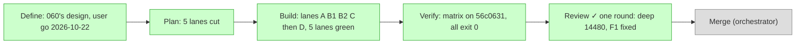

# 028 The footer badge says the deployed version, not the image's build ref

status: merged · rank: 3 · level: standard · type: fix · request: learn-pali 060 (the user, 2026-10-22: «apply le badge sur search / map / learn») · twin of learn-pali 060 (its design, validated and reviewed over three rounds, is the copy of record below; this task applies it to search-front)

## Summary
Rank: difficulty 3, impact 3 → 3. The same defect as learn-pali 060: the footer badge is baked into the content-addressed image, so a prod tag whose inputs equal main's shows `main · sha`. The same cure, already built, reviewed and merged in learn-pali (read its code as the model: `app/src/release.rs`, `app/src/app.rs` metas and `site_footer.rs`, `scripts/release-values.sh` + test, `scripts/rollout-check.sh` release gate, `.github/workflows/deploy.yml` step current/deploy/check, `infra/gcp.tf` ignore_changes, `infra/scripts/lifecycle.test.sh`, `app/tests/no_build_git.rs`, the READMEs): the env vars `SEARCH_FRONT_ENV` and `SEARCH_FRONT_SHA` on the Cloud Run revision (search-front-dev / search-front-prod), written by the deploy with `--update-env-vars` only; the server reads them at start (absent → `dev`), writes two metas, the client reads the metas (missing → `unknown`); prod `v0.x.y` alone, main `main · sha7`, a branch dispatch `branch · sha7`; the skip compares image AND release; the gate asserts the metas before traffic moves (exit 8, never retried); tofu ignores the container env (applied before the first env write: the orchestrator runs the apply); the git capture, build.rs's part and the Dockerfile ARGs removed with a grep test; every new test file has its CI step. Adapt names to this repository (crate, env prefix `SEARCH_FRONT`, host search.palicanon.app); where this repository differs (its deploy workflow, its Worker, its tests), say so in the Log and keep the design's invariants. ui-lib 0.4.0's EnvBadge takes owned strings (an empty sha drops the separator).
Open: none for the design; the lead's plan may find repository specifics.

## Workflow

## Log
| Step | Result | Output |
| --- | --- | --- |
| Define | done | the design is learn-pali 060's v4 (consensus and three review rounds there); the user's go 2026-10-22 |
| Plan | done | lead (Sonnet): lanes below; a2m impact blind to the consts and `view!` tags, found by grep (`app/src/app.rs:25-40`, `app/src/components/site_footer.rs:7-24`, `app/build.rs`, `Dockerfile:69-76`, `deploy.yml:107-111`, `scripts/check_workflows.py:121-131`); open branches: `feat/deploy` (stale 007, content already on main), `fix/hashed-assets` (task file only), `fix/search-front-proxy-target` (`infra/worker/*` only): no overlap; paired `wt/sf028/ui-lib` at 943e949 (v0.4.0) and `wt/sf028/api` at 031234b; the design block was missing from this file: 060's v4 copied below verbatim |
| Build, lanes | done | A c21d9df 18d9e89 (release.rs, document metas `search-release-*`, footer, hydrate reader, wasm test; lib 329 to 351, red 13/17 on stubs then 5), B1 2670129 (the `release` check, exit 8, usage exit 2; site_scripts 27 to 32), B2 4e3f989 6330734 705b2ca (release-values.sh + 257 checks, deploy.yml, ci.yml, check_workflows rule inverted, test 76 to 83), C 453fe8a + my fix 8b8f629, D fd62e6c cb40b76 56c0631 (build.rs, git_info.rs, Dockerfile ARGs removed, boot log line, README; lib net 333 on main's tree, boot_process 8, no_build_git 3). Lane reds and mutations are in the process thread. Mutation 4 of A (hydrate forgetting provide_context) is not catchable natively: guarded by review. |
| Build, lead fix | done | C copied 060's recovery sentence (`gh workflow run deploy.yml --ref v0.1.8`, a branch dispatch) though deploy.yml has no workflow_dispatch: README promised a trigger that does not exist; 8b8f629, test first (red 2, then lifecycle.test.sh 18/0). |
| Rebase | done | on main 4fa2460 (027, 026): one conflict, app/src/app.rs imports of A's commit (027 moved HashedStylesheet into the document and removed Stylesheet from App), resolved as the orchestrator ruled (a): `#[cfg(feature = "ssr")] use leptos_meta::{HashedStylesheet, MetaTags};` + `use leptos_meta::{Title, provide_meta_context};`; no behaviour change; no other conflict; the resolved hunk goes to the review. |
| Verify | done | on 56c0631 (code tip; this task-file commit follows): exit lines: fmt 0, leptosfmt 0, clippy ssr 0, hydrate 0, csr 0, test_ssr 0 (lib 333, boot_process 8, cfg_gates 6, check_wasm_script 12, csr_tree 2, hashed_assets 2, image_context 11, image_hash_script 7, no_build_git 3, site_scripts 32), doc_ssr 0 (RUSTDOCFLAGS -D warnings), wasm release_document 0 (6 passed), wasm csr+csr_mount 0 (13 + 1), `cargo leptos build --release --cargo-locked` 0, scripts/check-wasm-no-token.sh 0, release-values.test.sh 0 (257/0), check_workflows_test.py + check_workflows.py 0 (83 tests, 0 violations), manifest-ref 10, serving-revision 12, origin-secret 37 (0), lifecycle.test.sh 0 (18), tofu fmt -check + init -backend=false + validate in a scratch copy 0, deploy.yml and ci.yml parse (PyYAML) 0, git_clean 0. ui-lib v0.4.0 = 943e949 (paired wt/sf028/ui-lib), api 031234b. A disk-full mid-run (cold targets of 4 lanes) cost one repeated test run; target dirs of finished lanes A and B1 removed. |
| Fix, infra revision | done | the orchestrator's read-only `tofu plan` (prod tfvars) showed `template.revision = "search-front-dev-00033-vam" -> null`: this repository's ignore list lacked `template[0].revision` (learn-pali's has it; the Lanes brief said not to add it, which was wrong: its "this service has no revision entry" was an assumption, not probed). 210c31e, test first: red `FAIL gcp.tf: ignore_changes holds template[0].revision` (18 passed, 1 failed), then lifecycle.test.sh 19/0 exit 0; shell suites 0; `tofu fmt -check` + `init -backend=false` + `validate` in a scratch copy 0; infra/README.md list and the gcp.tf comment updated. Review ran on the earlier tip 3138ccc; this hunk is orchestrator-checked. |
| Fix, review F1 | done | 7e5edfe: release-values.sh refuses a ref name outside [A-Za-z0-9._/-]; release-values.test.sh exit 0 (306/0; the deploy-step cases are in it), check_workflows_test.py 83 OK, checker 0 violations; orchestrator-checked, no second round. Tip below. |
| For the merge | todo | (1) the orchestrator's `tofu apply` of lane C BEFORE the first deploy that writes `SEARCH_FRONT_ENV` (gcloud's `--update-env-vars` then keeps the env; otherwise the next apply strips it); (2) first dev deploy: the image tag changes once (Dockerfile text is in the hash), read the revision JSON `.spec.containers[0].env` for an empty `SEARCH_FRONT_SHA` on a tag and for `main` + sha7 on dev, and `curl` the page's two metas; (3) no workflow_dispatch exists here, so no branch badge: not in the design's reach, a follow-up if wanted. |

## Reviews

### Round 1 - 2026-10-22 (the only one, rank 3: one round, one voice)
Reviewer: review da2d45ec57eba42 (v2) on tip 3138ccc, diff 169,692 characters against Deep's 60,000-character window: 10 of 25 files pasted whole, 15 as one line each (not read whole: site_footer.rs, release_document.rs, site_scripts.rs, release-values.test.sh, lifecycle.test.sh, no_build_git.rs, boot_process.rs, image_context.rs, check_workflows.py and its test, build.rs, the READMEs). Voice: deep 14480 (6 delta, 5 T, 6 changes). The reviewer's close (14481) got gemini 14482 (error list incomplete: the unread test files). Orchestrator ruling 14483.
Taken in, fixed by the lead, orchestrator-checked, no second round:
- F1 `scripts/release-values.sh` refuses a ref name holding any character outside `[A-Za-z0-9._/-]` (exit 1, the ref named on stderr), so the env value, the meta the server escapes and the gate's raw compare always agree (deep delta 1, delta 2, T1). 7e5edfe, test first: red 306 checks, 47 failed on the unfixed script (72939f1's, through RELEASE_TEST_SCRIPT), the failures being `feat/a&b`, `feat/a>b`, `feat/a"b`, `feat/a=b` and a tag `v1&2` accepted (exit 0 where 1 wanted); green 306 checks, 0 failed, with `feat/a.b-c_d/e` and `v0.1.8-rc.1` accepted and the refused ref named on stderr; one mutation (the class widened to `[^,[:space:]]` on a copy through RELEASE_TEST_SCRIPT) gives 47 failed. A mutation adding `&` to the class does not run (bash rejects an unquoted `&` in a regex), which is why the widening is the other way.
Ruled out, with the reason (orchestrator, 14483):
- a CI step named for `no_build_git.rs` (deep change 6): it runs in the ssr `cargo test` job;
- tofu ignoring the env also hiding the `SEARCH_API_TOKEN` reference's drift (delta 4): by design, written in infra/README.md;
- `same` exit 2 deploying (delta 5): by design (never a skip, never a dead job);
- `--set-env-vars` asserted in check_workflows.py (T2, change 2): `check_workflows_test.py` already has `test_the_set_variant_of_the_flag_is_refused_anywhere`;
- `--via-worker` asserting the metas after the traffic (T3, change 4): it reads nothing of the release by design (tested); the gate runs before the traffic moves;
- the apply order as a test (T4, change 5): it is a README sentence, asserted by lifecycle.test.sh;
- the tag's empty sha at the usage boundary (T5): tested by B1.
Not reviewed by a voice (named, not accepted by silence): the 15 files above, read in the lanes' own red/mutation proofs and by the matrix; the rebase hunk of app.rs (read by deep as "wording only", delta 6).

## Lanes
Plan 2026-10-22 (lead). Model code: learn-pali main 23c7ae2 (060 merged), read-only copies in the lead's scratch `model/`.

The contract the lanes share (names adapted from 060; every other rule is 060's):
- env vars `SEARCH_FRONT_ENV` / `SEARCH_FRONT_SHA` on the Cloud Run revision; metas `search-release-env` / `search-release-sha` in the SSR head;
- `scripts/release-values.sh` prints `SEARCH_FRONT_ENV=<v>,SEARCH_FRONT_SHA=<v>`, modes `env`, `sha`, `same` (as 060);
- `scripts/rollout-check.sh URL [HEADER_FILE]` (the direct mode: this repository has no `revision` keyword) takes `ROLLOUT_EXPECT_ENV` (non-empty) and `ROLLOUT_EXPECT_SHA` (set, may be empty), exits 8 on a meta mismatch; a missing variable is a usage error, exit 2 (this script's usage code, not 060's 64); `--via-worker` and `--refused` neither read nor need them.

Where this repository differs from learn-pali (kept invariants, adapted mechanism):
1. the rollout gate tests are Rust integration tests (`app/tests/site_scripts.rs`, run by `cargo test`), not a shell suite; the shell tests of the deploy's skip logic live in the new `scripts/release-values.test.sh`;
2. `scripts/check_workflows.py` (+ its test) enforces today's `BUILD_BRANCH`/`BUILD_SHA` build args: the rule is inverted (no build args; the deploy step passes `scripts/release-values.sh` to `--update-env-vars`; the gate gets the expectation);
3. `deploy.yml` has no `workflow_dispatch` (learn-pali's 055 is not here): the branch case of `release-values.sh` serves `main` only; no trigger is added (a design change, not this task);
4. the Dockerfile is at the repository root, the build context is the parent folder, and the hash (`scripts/image-hash.sh`) covers `Dockerfile` and `scripts/`: removing the ARGs changes the next image tag, once;
5. the csr build (the PaliCanon app's fragment) compiles `release.rs` too (`pub mod release`, nothing feature-gated except `server` on ssr and `from_document` on browser); `app/tests/cfg_gates.rs` allows `hydrate` only in `lib.rs` and `csr` only in the fragment.

| Lane | Files | Tests (first) | Code | Model |
| --- | --- | --- | --- | --- |
| A Rust | `app/src/release.rs` (new), `app/src/app.rs`, `app/src/components/site_footer.rs`, `app/src/lib.rs` (add `pub mod release`, the hydrate wrapper; `mod git_info` stays for D), `app/tests/release_document.rs` (new, wasm) | unit (`ReleaseInfo` from vars: value, blank, absent, sha cut to 7, tag with no sha; from metas: both, missing one, none, whitespace); SSR render of `document` (metas in head after the viewport, badge text per case, no dot for a tag); `unknown` when no context; wasm test of the hydrate reader | `ReleaseInfo`, `shell`/`document` (ssr), footer reads the context, `hydrate` provides `from_document()` | Sonnet |
| B1 rollout gate | `scripts/rollout-check.sh`, `app/tests/site_scripts.rs` | the meta mismatch (exit 8) per meta and per failure kind, the two required variables (exit 2), a healthy page with the right metas, the other modes unaffected, the secret never printed in the 8 message | the `release` check in direct mode | Sonnet |
| B2 deploy | `scripts/release-values.sh` (new), `scripts/release-values.test.sh` (new, incl. the skip logic run on deploy.yml's `current` step with a stub gcloud), `.github/workflows/deploy.yml`, `.github/workflows/ci.yml`, `scripts/check_workflows.py`, `scripts/check_workflows_test.py` | literal-value test per event; `same` fixtures; the `current` step with image equal / env different; wiring greps (no `--set-env-vars`, no `build-args`, the deploy passes the script's output, the gate gets the expectation and exit 8 is named); checker rule inverted | the script, deploy.yml, the checker, the three ci.yml steps (`release_document` wasm, `release-values.test.sh`, `lifecycle.test.sh`) | Sonnet |
| C infra | `infra/gcp.tf`, `infra/README.md`, `infra/scripts/lifecycle.test.sh` (new) | grep test: `ignore_changes` holds the container env and the old entries (`image`, `scaling`, `client`, `client_version`), the apply order is written | `ignore_changes` + README paragraph; `tofu fmt -check`, `validate` in a scratch copy | Haiku |
| D cleanup (after A) | `app/build.rs`, `app/src/git_info.rs` (deleted), `app/src/lib.rs` (drop `mod git_info`), `Dockerfile`, `app/src/main.rs`, `app/tests/boot_process.rs`, `app/tests/image_context.rs`, `app/tests/no_build_git.rs` (new), `README.md` | grep test: no `SEARCH_FRONT_GIT`, `git_info`, `BUILD_BRANCH`, `rev-parse` in build files and sources; the Dockerfile test inverted (no ARG BUILD_*); the boot log line | removals; the boot `release:` line; README (Deploy section, badge) | Sonnet |

Apply order (for the orchestrator): tofu apply of lane C BEFORE the first deploy that writes `SEARCH_FRONT_ENV`, or the next apply strips the env and the badge reads 'dev' with no diff shown.
Base counts (ssr tests, main before the task): lib 329, boot_process 7, cfg_gates 6, check_wasm_script 12, csr_tree 2, image_context 11, image_hash_script 7, site_scripts 27; check_workflows_test.py 76.

## Design
Viewer: search-front-028-version-from-deploy/design (dcc10899092e04e), v1 = learn-pali 060's design v4 (consensus 2026-10-22 there), pasted unchanged: its names read LEARN_PALI_ENV / LEARN_PALI_SHA / learn-release-*; here SEARCH_FRONT_ENV / SEARCH_FRONT_SHA / search-release-* (the Lanes contract above).

```mermaid
flowchart TB
  today["today: the footer badge ('main · 34c489c', 'v0.1.7 · ebf34fa') is baked into the image at build time (const env! from build.rs: build args LEARN_PALI_GIT_BRANCH/COMMIT, else git); images are content-addressed (h-hash of app, core, Cargo files, ui-lib commit), so a prod tag whose inputs equal main's reuses main's image and its badge says 'main' (seen 2026-10-17, v0.1.8)"]
  inv["invariant: what the badge says is a property of the DEPLOY REVISION (which ref was rolled out), not of the image; one value, written once by deploy.yml onto the revision, read by the server at start, handed to the browser through the SSR document. The image is identical across refs"]
  today --> inv
  subgraph WRITE["write: deploy.yml (the only writer; tofu never touches it)"]
    vals["two values mirroring the badge's two fields: LEARN_PALI_ENV = the tag name (v0.1.8) | main | the branch (dispatch, 055); LEARN_PALI_SHA = empty for a tag, sha7 otherwise. The workflow passes data, it parses nothing"]
    deploy["gcloud run deploy ... --update-env-vars LEARN_PALI_ENV=..,LEARN_PALI_SHA=.. (never --set-env-vars: it wipes RUST_LOG and the ORIGIN_SECRET reference, and every request would then be refused). The image build loses its badge build args: its hash no longer changes with the ref"]
    skip["'already running?' compares the SERVING revision's image AND its two env values to the intended ones; absent and empty compare equal (a jq default), so a tag release does not redeploy forever; any other difference deploys a new revision (same image, new env). So every push to main makes a revision and the dev badge shows the pushed sha; v0.1.9 with main's inputs still deploys"]
    tofu["infra/gcp.tf: ignore_changes gains the container env, like image and scaling today: a later tofu apply cannot rewrite the template and flip the badge. A RUST_LOG or ORIGIN_SECRET edit after creation is a gcloud update or tofu apply -replace, written in infra/README.md. Order: this ignore is applied (tofu apply) BEFORE the first deploy that writes the env, or the next apply strips it and the badge reads 'dev' with no diff shown"]
    vals --> deploy --> skip
    tofu -.-> deploy
  end
  subgraph READ["read: the Rust side"]
    srv["server at start: ReleaseInfo { env, sha } from the two vars; absent or blank env → env 'dev', sha empty (local run; no git capture any more); sha is cut to 7 characters. build.rs capture_git_info, git_info.rs, the Dockerfile ARGs and the env! consts are deleted"]
    ssr["SSR document: ReleaseInfo written in <head> as <meta name='learn-release-env'> and <meta name='learn-release-sha'>, rendered into the footer badge from the same value"]
    cli["hydrate entry reads the two metas before mounting and provides the same ReleaseInfo to App: the client never recomputes, so SSR and hydration agree. The SSR always writes the metas and the rollout gate asserts them, so a missing one is a broken page: the client then shows 'unknown' (never 'dev', which is the local run's word, so a fault is not mistaken for a benign state)"]
    app["desktop app (client only, no server): its own version at build time (CARGO_PKG_VERSION / tauri.conf.json), same footer, same component; not learn's env"]
    srv --> ssr --> cli
    app -.-> cli
  end
  badge["footer badge wording: prod tag 'v0.1.8' (no dot, no sha); dev 'main · 34c489c'; a dispatched branch 'feat/x · 34c489c'; local run 'dev'. ui-lib EnvBadge takes owned strings and an empty sha drops the separator and the sha (additive ui-lib change, released, then a tag bump here); EnvBadgeInfo and the shell's prop are untouched"]
  inv --> WRITE
  deploy --> srv
  cli --> badge
  gate["rollout gate: rollout-check.sh already curls the tagged revision's URL; it also asserts the document's learn-release metas equal the intended values (reads what a browser gets, not what the workflow computed); a mismatch fails before the traffic moves, with a message and an exit code of its own (a wrong release is not a flaky curl). A skip path deploys nothing and is not re-gated: the serving revision was gated when it shipped. Rollback to PREV restores PREV's own env: the badge follows the traffic"]
  deploy --> gate
  gate --> badge
  tests["tests: unit (ReleaseInfo from env: value, blank, absent, sha cut to 7, tag with no sha); SSR render (metas in head, badge text per case, the footer shows no dot for a tag); hydrate entry reads the metas (wasm-free helper over strings); a script test in CI of scripts/release-values.sh, which reads the variables Actions provides (GITHUB_REF_TYPE, GITHUB_REF_NAME, GITHUB_SHA) and prints the two values; the test feeds it each event (push main, tag v0.1.8, dispatch of feat/x, a blank sha) and compares to LITERAL expected values (independent of the script, so it proves the rules); a wiring test greps deploy.yml: the deploy step calls the script and passes its output to --update-env-vars, no --set-env-vars anywhere, no LEARN_PALI_GIT build-args left (it proves the workflow calls it; the gate compares the served page to the same script, so it catches wiring and rollout faults but not a wrong script, which the literal-value test does); rollout-check.test.sh gains the meta mismatch case; ui-lib EnvBadge tests (empty sha, owned strings)"]
  badge --> tests
  sf["search-front: the same defect, its own task mirrors this one after ui-lib releases the EnvBadge change"]
  inv -.-> sf
```

| Apply | done | orchestrator, 2026-10-22: `tofu plan` with prod.tfvars: no resource change (the revision ignore added first, 210c31e); `tofu apply` complete: 0 added, 0 changed, 0 destroyed |
| Check | done | the user's go for the badge on search/map/learn (2026-10-22); orchestrator: F1 diff read; the dev metas read after the merge |
| Merge | done | 861e269 on main (squash), pushed: the dev deploy is the first env write (the image tag changes once: the Dockerfile); prod by tag v0.1.7 after the dev metas are read |
