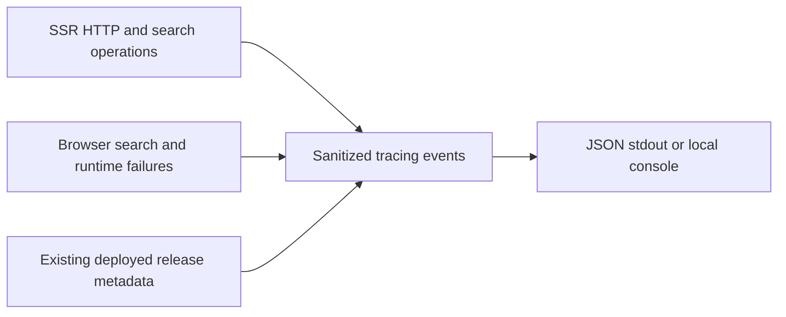

# 033 Structured search-front logs

status: merged locally · rank: 4 · level: standard · type: feature

## Request and target

2026-11-13: merge Learn and API logging, then apply the same approach to the
front. The two local main merges are 684e51d (Learn) and 0542109 (API).
Neither is pushed or deployed. This task starts at 95e1f44, preserving the
existing pending-opacity fix on the user's branch without switching it.

Emit JSON stdout for SSR and JSON console for the hydrated site, without
an exporter/backend. Identity: namespace palicanon, service search, deployed
tag in service.version, separate commit/environment, server/browser runtime.
Use the existing release metas and add a deployment-environment meta. The
CSR host owns its subscriber; the fragment never installs one implicitly.

Cover lifecycle, normalized HTTP summaries, bounded origin refusals, API
timings and typed failures, language fallback, logical search outcomes,
server-function failures and panics. Never emit query text, URL, headers,
token, raw exception, upstream error code/message or result text. Do not
change routes, search outcomes, fallback, UI or API request behavior.

## Plan and acceptance

1. Reuse Learn's tested native/browser adapter pattern with search identity.
2. Replace text writers and add bounded outcome events; migrate legacy
   log-line assertions to actual emitted JSON.
3. Verify actual JSON, tag propagation, redaction, HTTP status severity,
   browser console and SSR/hydrate/CSR feature separation.
4. Run SSR tests, three-mode clippy, docs and formatting. Commit locally;
   merging this new front branch is not part of the prior two merge requests.

## Log

- Define: current search-front source inspected; Leptos conventions apply.
  Its release badge already has deploy tags. Siblings are isolated archives
  of ui-lib v0.4.5 and the newly merged API main, not mutable shared checkouts.
- External independent model review is unavailable: automatic approval
  rejected exporting private diffs to Claude. No export or retry is made.

## Result and verification

- JSON stdout SSR and local JSON console for hydration are implemented. The
  existing release tag/ref and short commit are retained, separate from the
  deployment environment; both runtimes share the head metas.
- Production text writes were replaced with sanitized events. Native HTTP
  request spans carry a generated ID, never an incoming header. Typed upstream
  failures retain status/category/duration and discard raw codes/messages.
- The rollout gate now detects `runtime.panic` as well as older panic/trap
  console text. Its added JSON-panic case failed before the script change,
  then passed. Existing script tests use short explicit retry budgets and their
  cold-page description matches the existing behavior (no rollout retry change).
- Preserved the pending-opacity fix at the branch base; leptosfmt normalized
  its existing Transition indentation without changing behavior.
- SSR: 425 tests passed across 18 suites, no failures, two ignored examples.
  Includes startup configuration failures, exact deployed tag/commit, request
  privacy, sampled origin refusals and a successful SIGTERM/service.stopped.
- Headless Chrome: 21 passed (13 fragment, 1 mount, 6 release document, 1 JSON
  console test). The console initializer runs once and preserves subscribers.
- Clippy with -D warnings: SSR all targets, hydrate wasm32 library, CSR wasm32
  all targets passed. Rustdoc with -D warnings, rustfmt, leptosfmt, diff check,
  workflow policy check and shell syntax passed. CSR wasm-bindgen bundle check
  found no token, token shape or API client. Existing proc-macro-error2 upstream
  future-compatibility notice remains; it is not a check failure.
- Local review checked event fields, error redaction, mode separation, release
  ownership and the rollout gate. This is not independent review. No PR, push,
  front merge, deploy, collector or dashboard was created.
- cargo sweep --time 7 completed; nothing old to remove. Disk remained above
  the 50 GiB cleanup threshold. Shared conformance-fixture follow-up remains
  proposed in Learn task 079; no new accepted shared-crate design is implied.

## Authorized local merge

2026-11-13: user requested "fusionne puis fait visualization". Main was
advanced to origin/main 667481e first; its opacity fix is byte-identical to
the original branch base 95e1f44. The duplicate-change conflict in page.rs
was resolved to the tested, formatted feature version. The entire staged
application tree matches ae98575 (git diff --exit-code excluding .task).
Earlier SSR/Chrome/clippy/docs checks therefore cover the resulting source;
no additional runtime behavior was introduced by integration.

Local closure review preserves the explicit limitation that independent
external review was blocked by approval policy. The shared conformance
proposal in Learn task 079 remains proposed. The later bot/noise question
exposes a separate, unimplemented follow-up: trusted edge classification,
route-specific quotas, bounded repetitive event samples and exact counters
for dashboards. No WAF, quota, sampling or deployment setting was changed
in this merge. This is a local main merge only; no push or deploy.
